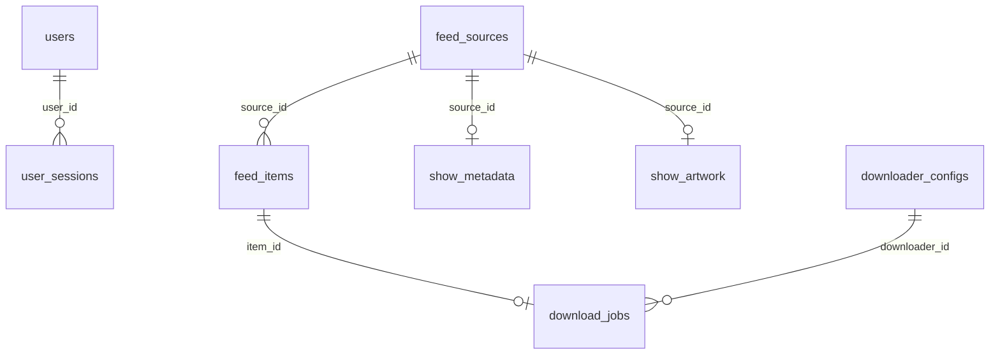

# 数据库表说明

本文依据当前工作区的 `backend\app\models.py`、`backend\app\database.py` 及相关业务代码整理，更新日期：2026-10-12。当前共定义 **13 张业务表**。

## 数据库与字段约定

- 使用 SQLAlchemy 异步 ORM，默认数据库为 SQLite。连接地址由 `MOONCELL_DATABASE_URL` 配置，默认 `sqlite+aiosqlite:///./data/mooncell.db`。
- 从 `backend` 目录启动时，默认数据库文件为 `backend\data\mooncell.db`；Docker 中为 `/app/data/mooncell.db`，映射到项目的 `data` 目录。
- 表格中的类型为 SQLAlchemy 模型对应的 SQL 类型；SQLite 中布尔值以整数表示，JSON 以序列化内容保存，`VARCHAR(n)` 的长度不会由 SQLite 自动强制限制。
- “默认值”指 ORM 插入时使用的默认值；`—` 表示未声明默认值，可空字段省略时通常保存为 `NULL`。除特别注明外，默认值不是数据库端的 `DEFAULT`。
- `当前 UTC 时间` 由 `utcnow()` 生成。时间字段声明为 `DateTime(timezone=True)`，SQLite 读回时可能不带时区信息，业务代码按 UTC 处理。
- 单列整数主键 `id` 未提供值时由 SQLite 生成。四张设置表的 `id` 默认值为 `1`，业务接口只读写该记录；数据库没有限制它们只能存在一行。
- 状态、类型等字符串取值由业务代码约定，没有数据库枚举或 `CHECK` 约束。

## 表清单

| 表名 | ORM 模型 | 用途 |
| --- | --- | --- |
| `users` | `User` | 管理员账户与密码摘要 |
| `user_sessions` | `UserSession` | 浏览器登录会话、令牌摘要与有效期 |
| `feed_sources` | `FeedSource` | RSS/Atom 订阅源、过滤条件与刷新状态 |
| `feed_items` | `FeedItem` | 订阅发现的发布条目、去重信息与标题解析结果 |
| `show_metadata` | `ShowMetadata` | 订阅关联的 TMDB 番剧元数据 |
| `show_artwork` | `ShowArtwork` | 番剧图片文件路径与刮削状态 |
| `downloader_configs` | `DownloaderConfig` | 下载器连接、凭据、路径映射与整理策略 |
| `download_jobs` | `DownloadJob` | 自动投递与文件整理的持久化任务 |
| `domain_events` | `DomainEvent` | 事件日志与 SSE 断线重连补发记录 |
| `subscription_settings` | `SubscriptionSettings` | 全局订阅代理与刷新间隔 |
| `tmdb_settings` | `TmdbSettings` | 加密保存的 TMDB 访问凭据 |
| `library_settings` | `LibrarySettings` | 全局媒体库目录 |
| `calendar_favorites` | `CalendarFavorite` | 季度追番日历收藏 |

## 表关系

设置表与 `calendar_favorites` 没有外键。`domain_events.resource_type` 和 `resource_id` 是业务资源引用，也没有数据库外键。

## 字段说明

### 1. `users`：管理员账户

| 字段 | 类型 | 可空 | 默认值 | 说明 |
| --- | --- | --- | --- | --- |
| `id` | INTEGER | 否 | 自动生成 | 主键 |
| `username` | VARCHAR(64) | 否 | — | 用户名，唯一 |
| `password_hash` | TEXT | 否 | — | PBKDF2-SHA256 密码摘要，包含迭代次数、随机盐与摘要 |
| `created_at` | DATETIME | 否 | 当前 UTC 时间 | 创建时间 |

约束：主键 `id`；唯一约束 `username`。唯一管理员的限制由业务代码实现，不由表结构限制行数。

### 2. `user_sessions`：登录会话

| 字段 | 类型 | 可空 | 默认值 | 说明 |
| --- | --- | --- | --- | --- |
| `id` | INTEGER | 否 | 自动生成 | 主键 |
| `user_id` | INTEGER | 否 | — | 外键，关联 `users.id` |
| `token_hash` | VARCHAR(64) | 否 | — | 会话令牌的 SHA-256 摘要，唯一；原始令牌保存在 Cookie 中 |
| `expires_at` | DATETIME | 否 | — | 会话过期时间，由业务代码计算 |
| `created_at` | DATETIME | 否 | 当前 UTC 时间 | 创建时间 |

约束：主键 `id`；唯一约束 `token_hash`；删除账户时通过外键 `ON DELETE CASCADE` 删除会话。

索引：`ix_user_sessions_user_id(user_id)`、`ix_user_sessions_expires_at(expires_at)`。

### 3. `feed_sources`：订阅源

| 字段 | 类型 | 可空 | 默认值 | 说明 |
| --- | --- | --- | --- | --- |
| `season` | INTEGER | 是 | — | 用户指定的番剧季度编号，与日历的年月季度编码不同 |
| `id` | INTEGER | 否 | 自动生成 | 主键 |
| `name` | VARCHAR(160) | 否 | — | 订阅名称，也用于默认媒体库番名 |
| `url` | TEXT | 否 | — | 订阅地址，唯一 |
| `kind` | VARCHAR(32) | 否 | `standard` | 订阅类型，如 `standard`、`mikan` |
| `excluded_keywords` | JSON | 否 | `[]` | 排除关键词数组，同时声明数据库端默认值 `[]` |
| `active` | BOOLEAN | 否 | `true` | 是否启用 |
| `refresh_interval_minutes` | INTEGER | 否 | `5` | 刷新间隔，单位为分钟 |
| `etag` | TEXT | 是 | — | HTTP 条件请求缓存标记 |
| `last_modified` | TEXT | 是 | — | HTTP Last-Modified 缓存值 |
| `connection_status` | VARCHAR(24) | 否 | `unknown` | 连接状态：`unknown`、`healthy`、`error` |
| `last_checked_at` | DATETIME | 是 | — | 最近刷新检查时间 |
| `last_error` | TEXT | 是 | — | 最近错误信息 |
| `created_at` | DATETIME | 否 | 当前 UTC 时间 | 创建时间 |
| `updated_at` | DATETIME | 否 | 当前 UTC 时间 | 更新时间，ORM 更新时调用 `utcnow()` |

约束：主键 `id`；唯一约束 `url`。没有额外声明的普通索引。

一个订阅源可关联多个发布条目，最多关联一条 TMDB 元数据和一条图片记录。

### 4. `feed_items`：发布条目

| 字段 | 类型 | 可空 | 默认值 | 说明 |
| --- | --- | --- | --- | --- |
| `id` | INTEGER | 否 | 自动生成 | 主键 |
| `source_id` | INTEGER | 否 | — | 外键，关联 `feed_sources.id` |
| `guid` | TEXT | 是 | — | RSS/Atom 原始条目标识 |
| `title` | TEXT | 否 | — | 原始发布标题 |
| `detail_url` | TEXT | 是 | — | 发布详情地址 |
| `download_url` | TEXT | 是 | — | 种子或磁力下载地址 |
| `info_hash` | VARCHAR(128) | 是 | — | 从下载地址提取的种子哈希 |
| `published_at` | DATETIME | 是 | — | 源站发布时间 |
| `fingerprint` | VARCHAR(64) | 否 | — | SHA-256 去重指纹 |
| `parse_status` | VARCHAR(24) | 否 | `parsed` | 解析及审核状态 |
| `parse_data` | TEXT | 否 | — | `ParsedRelease` 序列化后的 JSON 文本 |
| `discovered_at` | DATETIME | 否 | 当前 UTC 时间 | 首次发现时间 |

约束：主键 `id`；联合唯一约束 `uq_feed_items_source_fingerprint(source_id, fingerprint)`；删除订阅源时级联删除条目。

索引：`ix_feed_items_source_id(source_id)`、`ix_feed_items_info_hash(info_hash)`、`idx_feed_items_source_published(source_id, published_at)`。

指纹由订阅 ID、GUID、下载地址（缺失时使用详情地址）和标题组合后计算。`info_hash` 在此表中不唯一；下载任务表另做全局去重。

`parse_status` 的业务取值包括 `parsed`（解析通过）、`needs_review`（待审核）、`ignored`（已忽略）、`superseded`（被更高修订版本替代）。

`parse_data` 保存原始标题、番名、发布组、媒体类型、发布类型、季度、起止集数、修订版本、分辨率、来源、字幕语言、音视频编码、封装格式、置信度、解析证据和警告，具体字段见 `backend\app\schemas.py` 的 `ParsedRelease`。

### 5. `show_metadata`：番剧元数据

| 字段 | 类型 | 可空 | 默认值 | 说明 |
| --- | --- | --- | --- | --- |
| `id` | INTEGER | 否 | 自动生成 | 主键 |
| `source_id` | INTEGER | 否 | — | 外键，关联 `feed_sources.id`，唯一 |
| `tmdb_id` | INTEGER | 否 | — | TMDB 作品 ID |
| `media_type` | VARCHAR(16) | 否 | — | TMDB 媒体类型：`tv` 或 `movie` |
| `title` | VARCHAR(240) | 否 | — | 作品标题 |
| `overview` | TEXT | 是 | — | 简介 |
| `poster_url` | TEXT | 是 | — | 海报 URL |
| `release_date` | VARCHAR(32) | 是 | — | 首播或上映日期，以字符串保存 |
| `genres_json` | TEXT | 否 | `[]` | 题材分类列表的 JSON 文本 |
| `episode_count` | INTEGER | 是 | — | 作品总集数，不按订阅季度筛选 |
| `rating` | FLOAT | 是 | — | TMDB 评分 |
| `vote_count` | INTEGER | 是 | — | TMDB 评分人数 |
| `href` | TEXT | 否 | — | TMDB 作品详情页地址 |
| `scraped_at` | DATETIME | 否 | 当前 UTC 时间 | 刮削时间 |

约束：主键 `id`；外键删除级联。唯一索引 `ix_show_metadata_source_id(source_id)` 保证每个订阅最多一条元数据；普通索引 `ix_show_metadata_tmdb_id(tmdb_id)`。不同订阅可以关联同一 TMDB 作品。

### 6. `show_artwork`：番剧图片记录

| 字段 | 类型 | 可空 | 默认值 | 说明 |
| --- | --- | --- | --- | --- |
| `id` | INTEGER | 否 | 自动生成 | 主键 |
| `source_id` | INTEGER | 否 | — | 外键，关联 `feed_sources.id`，唯一 |
| `directory` | TEXT | 否 | — | 番剧图片保存目录 |
| `poster_path` | TEXT | 是 | — | 海报文件路径 |
| `fanart_path` | TEXT | 是 | — | 背景图文件路径 |
| `clearlogo_path` | TEXT | 是 | — | 透明标题图文件路径 |
| `status` | VARCHAR(24) | 否 | `pending` | 刮削状态：`pending`、`completed`、`partial`、`failed` |
| `last_error` | TEXT | 是 | — | 最近刮削错误 |
| `scraped_at` | DATETIME | 是 | — | 刮削时间 |

约束：主键 `id`；外键删除级联；唯一索引 `ix_show_artwork_source_id(source_id)`。

此表只保存文件路径和状态，图片内容存放在文件系统中。

### 7. `downloader_configs`：下载器配置

| 字段 | 类型 | 可空 | 默认值 | 说明 |
| --- | --- | --- | --- | --- |
| `id` | INTEGER | 否 | 自动生成 | 主键 |
| `name` | VARCHAR(120) | 否 | — | 下载器名称 |
| `kind` | VARCHAR(24) | 否 | — | `qbittorrent` 或 `aria2` |
| `base_url` | TEXT | 否 | — | 下载器接口地址 |
| `username` | VARCHAR(160) | 是 | — | 登录用户名 |
| `encrypted_secret` | TEXT | 是 | — | Fernet 加密的密码或 RPC Secret |
| `verify_tls` | BOOLEAN | 否 | `true` | 是否验证 TLS 证书 |
| `active` | BOOLEAN | 否 | `true` | 是否启用 |
| `remote_download_root` | TEXT | 是 | — | 下载器可见的远程根目录 |
| `local_download_root` | TEXT | 是 | — | 服务可见的本地根目录，用于路径映射 |
| `library_root` | TEXT | 是 | — | 下载器配置中的媒体库目录回退值 |
| `organize_strategy` | VARCHAR(32) | 否 | `downloader_managed` | 整理策略 |
| `connection_status` | VARCHAR(24) | 否 | `unknown` | `unknown`、`healthy`、`error` |
| `last_checked_at` | DATETIME | 是 | — | 最近连接测试时间 |
| `last_error` | TEXT | 是 | — | 最近连接错误 |
| `created_at` | DATETIME | 否 | 当前 UTC 时间 | 创建时间 |
| `updated_at` | DATETIME | 否 | 当前 UTC 时间 | 更新时间，ORM 更新时调用 `utcnow()` |

约束：仅主键 `id`，没有额外声明的唯一约束或普通索引。

接口接受 `downloader_managed`、`hardlink`、`copy` 三种策略，当前自动队列使用启用的 qBittorrent 配置和 `downloader_managed` 策略；aria2 当前支持连接配置和测试。

### 8. `download_jobs`：下载与整理任务

| 字段 | 类型 | 可空 | 默认值 | 说明 |
| --- | --- | --- | --- | --- |
| `id` | INTEGER | 否 | 自动生成 | 主键 |
| `item_id` | INTEGER | 否 | — | 外键，关联 `feed_items.id`，唯一 |
| `info_hash` | VARCHAR(40) | 否 | — | 种子哈希，全表唯一 |
| `downloader_id` | INTEGER | 否 | — | 外键，关联 `downloader_configs.id` |
| `state` | VARCHAR(24) | 否 | `queued` | 自动化处理状态 |
| `target_root` | TEXT | 否 | — | 已转换为下载器可见路径的媒体库根目录 |
| `title` | TEXT | 否 | — | 整理使用的番名 |
| `season` | INTEGER | 否 | — | 整理使用的季度编号 |
| `plan` | TEXT | 是 | — | 文件筛选、重命名及整理计划的 JSON 文本 |
| `last_error` | TEXT | 是 | — | 最近任务错误 |

约束：主键 `id`；`item_id`、`info_hash` 分别唯一。删除发布条目时级联删除任务；`downloader_id` 外键没有声明删除级联。没有额外声明的普通索引。

常见状态包括 `queued`（待投递）、`metadata`（等待元数据）、`organizing`（筛选和重命名）、`moving`（移动目录）、`done`（自动整理完成）、`existing`（检测到已有外部任务）、`needs_review`（需人工审核）、`ignored`（已忽略）、`superseded`（被更高修订版本替代）。队列代码还识别 `upgrading` 状态。

`done` 表示自动投递和整理流程完成，实际下载是否完成由下载器实时状态决定。进度、速度、剩余时间没有单独持久化字段。

普通整理计划包含 `wrapper`、`season_folder`、`files`（`old`/`new` 路径）、`skip_file_ids` 和 `selection_version`；业务流程可以写入额外字段。

### 9. `domain_events`：事件日志

| 字段 | 类型 | 可空 | 默认值 | 说明 |
| --- | --- | --- | --- | --- |
| `id` | INTEGER | 否 | 自动生成 | 主键，同时用于 SSE 事件定位 |
| `event_type` | VARCHAR(80) | 否 | — | 事件类型，如 `download.failed` |
| `resource_type` | VARCHAR(80) | 是 | — | 相关资源类型，如 `calendar` |
| `resource_id` | VARCHAR(80) | 是 | — | 相关资源 ID，以字符串保存 |
| `payload` | TEXT | 否 | `{}` | 事件详情的 JSON 文本 |
| `created_at` | DATETIME | 否 | 当前 UTC 时间 | 事件时间 |

约束：仅主键 `id`，无外键。

索引：`ix_domain_events_event_type(event_type)`、`idx_domain_events_created(created_at)`。

此表用于日志展示、审核操作审计，以及 SSE 断线后补发持久化事件。

### 10. `subscription_settings`：全局订阅设置

| 字段 | 类型 | 可空 | 默认值 | 说明 |
| --- | --- | --- | --- | --- |
| `id` | INTEGER | 否 | `1` | 主键，业务固定读写 ID 1 |
| `proxy_url` | TEXT | 是 | — | 订阅请求使用的代理地址 |
| `refresh_interval_minutes` | INTEGER | 否 | `5` | 全局刷新间隔，单位为分钟 |

约束：仅主键 `id`。保存设置时同步更新 `feed_sources.refresh_interval_minutes`；自动刷新循环读取此表的全局间隔。接口校验范围为 1～1440 分钟。

### 11. `tmdb_settings`：TMDB 凭据

| 字段 | 类型 | 可空 | 默认值 | 说明 |
| --- | --- | --- | --- | --- |
| `id` | INTEGER | 否 | `1` | 主键，业务固定读写 ID 1 |
| `encrypted_read_access_token` | TEXT | 是 | — | 加密后的 TMDB API 读访问令牌 |
| `encrypted_api_key` | TEXT | 是 | — | 加密后的 TMDB API 密钥 |

约束：仅主键 `id`。凭据通过 `MOONCELL_SECRET_KEY` 派生的 Fernet 密钥加密；接口只返回是否已配置。同样的加密机制用于下载器凭据。

### 12. `library_settings`：媒体库设置

| 字段 | 类型 | 可空 | 默认值 | 说明 |
| --- | --- | --- | --- | --- |
| `id` | INTEGER | 否 | `1` | 主键，业务固定读写 ID 1 |
| `library_root` | TEXT | 否 | — | 全局媒体库根目录 |

约束：仅主键 `id`。目录选择优先级为：本表配置 → 调用方提供的回退目录（如下载器配置）→ `MOONCELL_MEDIA_LIBRARY_ROOT`。

### 13. `calendar_favorites`：日历收藏

| 字段 | 类型 | 可空 | 默认值 | 说明 |
| --- | --- | --- | --- | --- |
| `season` | VARCHAR(6) | 否 | — | 季度编码：`YYYY01`、`YYYY04`、`YYYY07`、`YYYY10` |
| `item_id` | INTEGER | 否 | — | 该季度日历缓存中的条目 ID |

约束：联合主键 `(season, item_id)`；没有外键或额外声明的索引。

`item_id` 指向季度 `season.json` 中的条目，不是 `feed_items.id`。记录存在即表示已收藏，取消收藏时删除记录；项目采用单用户设计，此表没有 `user_id`。

## 初始化与结构更新

后端启动时调用 `init_database()`，通过 `Base.metadata.create_all()` 创建尚不存在的表。SQLite 连接启用 `PRAGMA foreign_keys=ON`，并设置 `busy_timeout=5000`。

初始化逻辑还会检查 `feed_sources`，在旧表缺少字段时补充：

- `season INTEGER`。
- `excluded_keywords JSON NOT NULL DEFAULT '[]'`。

当前没有使用 Alembic 等版本化迁移机制。`create_all()` 不会自动更新已有表的其他字段、索引或约束，因此本文描述的是当前模型定义，旧数据库的实际结构可能不同。

## 数据库之外的持久化内容

| 内容 | 保存位置或方式 |
| --- | --- |
| 季度日历正文 | 默认 `backend\data\calendar\YYYYMM\season.json`，可通过 `MOONCELL_CALENDAR_CACHE_PATH` 修改缓存根目录 |
| 日历封面 | 同季度目录中的 `<item_id>.img` 文件 |
| 番剧图片 | 番剧媒体库目录中的文件，由 `show_artwork` 保存路径 |
| 下载进度、速度、剩余时间 | 从下载器实时读取，没有对应的独立数据库表 |
| 人工审核记录 | 当前状态保存在 `feed_items`、`download_jobs`，操作审计保存在 `domain_events` |

## 代码参考

- 模型与字段定义：`backend\app\models.py`。
- 连接、首次建表和兼容更新：`backend\app\database.py`。
- 发布解析 JSON 结构：`backend\app\schemas.py` 的 `ParsedRelease`。
- 自动投递与整理：`backend\app\download_queue.py`。
- 审核与版本选择：`backend\app\review.py`、`backend\app\release_versions.py`。
- 设置持久化：`backend\app\subscription_settings.py`、`backend\app\tmdb_settings.py`、`backend\app\library.py`。
- 日历缓存与收藏：`backend\app\calendar_service.py`。
- 密码、令牌摘要与凭据加密：`backend\app\security.py`。
