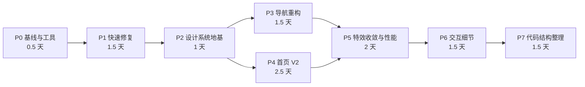
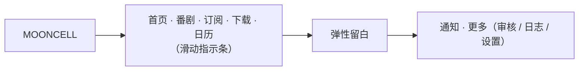
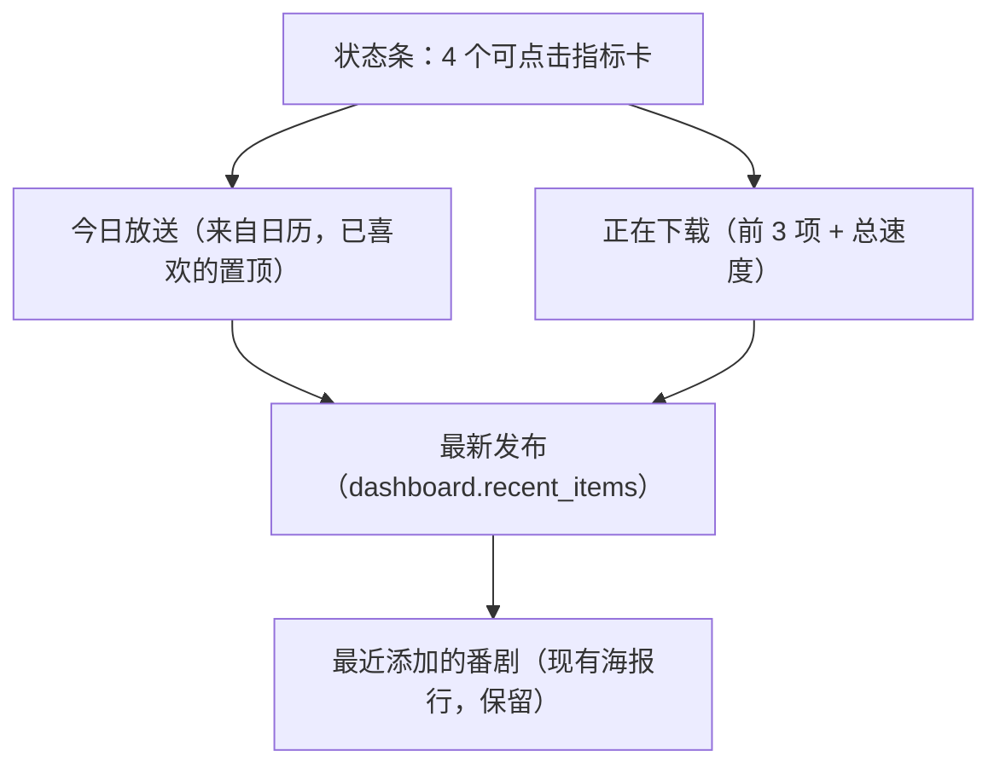

# Mooncell 前端优化开发计划

> 执行进度：见 [前端优化执行记录](frontend_optimization_progress.md)（2026-10-22：P0–P7 代码实施完成；集显实机 FPS / GPU 占用验收待补）。

> 依据：上一轮前端风格与交互评价。目标是把 Mooncell 从「特效展示型界面」调整为「高效、克制、有质感的管理工具」，保留现有工程优势（令牌体系、可访问性、Spring 动效、细节交互）。

## 0. 总体目标与验收指标

| 维度 | 现状 | 目标 |
| :--- | :--- | :--- |
| 页面切换 | 每次 2 次点击 + 抽屉动画 | 桌面端 1 次点击 |
| 番剧页首屏 | 等待全部图片解码（单张最多 15s） | 数据到达即渲染，图片逐张淡入 |
| 滚动帧率 | 多层 `backdrop-filter` 叠加动态 WebGL 背景 | 集显 1080p/4K 下番剧页、日历页滚动稳定 60fps，无 >50ms 长任务 |
| 首页 | 随机画廊 + 最近 5 部 | 状态总览：更新 / 下载 / 待审核 / 异常，一屏可达 |
| 视觉一致性 | 13 种特效组件、硬编码颜色、9–11px 字号 25 处 | 统一组件语言，最小字号 12px，TSX 中无硬编码色值 |
| 动效 | Spring 与时长缓动混用 | 位移/缩放统一 Spring 预设；仅颜色类过渡允许时长 |
| 可维护性 | 千字符单行 JSX、任意值类名数百处 | 页面拆分子组件，令牌工具类化 |



预计总工作量约 **12 人日**。每个阶段独立提交，可单独回滚。

---

## P0 基线与验证工具（0.5 天）

先量化现状，否则后续"性能提升"无法证明。

| # | 任务 | 说明 |
| :--- | :--- | :--- |
| 0.1 | 打包体积基线 | `pnpm --dir frontend build`，记录各 chunk 大小（gzip）存入 `.cache/perf/baseline-bundle.txt` |
| 0.2 | 渲染性能基线 | Edge DevTools Performance：番剧页（≥30 部、卡片视图）匀速滚动 5 秒、日历切换星期、首页静置 10 秒；记录 FPS、GPU 占用、长任务数 |
| 0.3 | 视觉回归脚本 | 复用 `.cache/staggered-menu-browser.cjs` 的 Playwright + 模拟接口方式，新增 `scripts/visual-check.cjs`：遍历 9 个路由 × 视口（375 / 768 / 1280 / 1440）× 两个主题，输出截图到 `.cache/visual/<阶段>/` |
| 0.4 | 复核移动端登录溢出 | 用 Playwright 设备模拟（iPhone 13）确认登录卡片是否真实溢出，若是则在 P1 修复 |

**验收**：基线数据与截图齐全，后续每阶段结束重跑同一脚本对比。

---

## P1 快速修复（1.5 天）

改动小、风险低、收益直接。

### 1.1 修正深海蓝主题强调色
- **文件**：[index.css](file:///f:/code/mooncell/frontend/src/index.css#L88-L138)、[theme.ts](file:///f:/code/mooncell/frontend/src/lib/theme.ts#L19-L28)
- **做法**：保留 `--accent: #122e8a` 作为品牌深海蓝；`--ink` 改为中性深灰蓝（候选 `#1d2433`），`--ink-2` / `--muted` 同步去饱和。截图对比两套候选后定稿。
- **验收**：正文、链接、选中态三者可区分；正文与背景对比度 ≥ 7:1，强调色文字 ≥ 4.5:1。

### 1.2 从主导航移除演示页「整理」
- **文件**：[app-shell.tsx](file:///f:/code/mooncell/frontend/src/components/app-shell.tsx#L12-L19)、[app.tsx](file:///f:/code/mooncell/frontend/src/app.tsx#L56)
- **做法**：`navigation` 删除 `/organizer`；路由仅在 `DEMO_MODE` 下注册，否则 `Navigate` 到 `/downloads`。
- **验收**：生产构建中不可达；开发演示模式仍可访问。

### 1.3 取消"等全部图片"门槛
- **文件**：[shows.tsx](file:///f:/code/mooncell/frontend/src/pages/shows.tsx#L38-L68)、[L145](file:///f:/code/mooncell/frontend/src/pages/shows.tsx#L145)、[calendar.tsx](file:///f:/code/mooncell/frontend/src/pages/calendar.tsx#L95-L113)
- **做法**：
  - 删除 `useArtworkReady`，加载判断只看 `showsQuery.isPending`。
  - 卡片/海报图片统一走 `FadeInImage`，容器已有固定高度或 `aspect-ratio`，不会产生布局跳动；首屏以外 `loading="lazy"`。
  - 滚动恢复改为数据到达后执行（布局不依赖图片尺寸）。
  - 日历删除 `CalendarDayContent` 的整体隐藏逻辑，保留 `Cover` 组件的单图骨架。
- **验收**：模拟慢图片（DevTools 限速 Slow 3G）时，卡片结构立即出现；从详情页返回后滚动位置正确。

### 1.4 首页轮播可控
- **文件**：[dashboard.tsx](file:///f:/code/mooncell/frontend/src/pages/dashboard.tsx#L65-L76)、[accordion-gallery.tsx](file:///f:/code/mooncell/frontend/src/components/accordion-gallery.tsx#L133)
- **做法**：画廊区域 `pointerenter/leave` 维护 `hovered`，`paused={focused || hovered || pageHidden}`；去掉悬停即展开，改为点击（已有）或 200ms 悬停意图延迟。
- **说明**：若 P4 决定移除画廊，本项仅做暂停修复即可。

### 1.5 含内部控件的卡片不再上浮
- **文件**：[shows.tsx](file:///f:/code/mooncell/frontend/src/pages/shows.tsx#L185)
- **做法**：卡片视图去掉 `whileHover={{ y: -5 }}`，保留边框高亮；海报视图（整块为链接）保留上浮。

### 1.6 记住视图偏好
- **文件**：[shows.tsx](file:///f:/code/mooncell/frontend/src/pages/shows.tsx#L92)
- **做法**：`view` 初始值优先级：返回状态 → `localStorage("mooncell-shows-view")` → `"cards"`；切换时写入。

### 1.7 清理未使用依赖
- **文件**：[package.json](file:///f:/code/mooncell/frontend/package.json)
- **做法**：移除 `@base-ui/react`（全仓无引用）。`gsap` 在 P5 处理。

**P1 验收**：`pnpm lint`、`pnpm test:player`、`pnpm build` 通过；视觉回归仅预期页面有差异。

---

## P2 设计系统地基（1 天）

为后续阶段提供干净的写法，避免新代码继续堆积任意值类名。

### 2.1 令牌映射为 Tailwind 工具类
- **文件**：[index.css](file:///f:/code/mooncell/frontend/src/index.css#L7-L19)
- **做法**：新增 `@theme inline`，把运行时变量映射为工具类：

```css
@theme inline {
  --color-ink: var(--ink);
  --color-ink-2: var(--ink-2);
  --color-muted: var(--muted);
  --color-accent: var(--accent);
  --color-accent-soft: var(--accent-soft);
  --color-on-accent: var(--on-accent);
  --color-surface: var(--surface);
  --color-surface-raised: var(--surface-raised);
  --color-border: var(--border);
  --color-border-soft: var(--border-soft);
  --color-danger: var(--danger);
  --color-warning: var(--warning);
  --color-success: var(--success);
  --text-caption: .75rem;
  --text-small: .8125rem;
  --text-body: .875rem;
}
```

> [!NOTE]
> 现有 `@theme` 已定义 `--radius-control` 等，`rounded-control` 工具类**现在就可用**，`rounded-[var(--radius-control)]` 写法本身是多余的。

### 2.2 动效预设集中管理
- **新增**：`frontend/src/lib/motion.ts`

```ts
export const spring = {
  snappy: { type: "spring", stiffness: 400, damping: 30 },
  gentle: { type: "spring", stiffness: 300, damping: 30 },
  layout: { type: "spring", stiffness: 320, damping: 30 },
  press:  { type: "spring", stiffness: 500, damping: 40 },
} as const
```

- 规则：位移、缩放、旋转、透明度入场一律使用预设；颜色、边框色允许 CSS `transition`（不属于运动）。

### 2.3 设计规范文档
- **新增**：`docs/design-system.md`，约定：
  - 强调色只用于主要操作、选中态、进度；普通链接用 `ink` + 下划线。
  - 字号阶梯：12 / 13 / 14 / 16 / 22 / 32+，**最小 12px**。
  - 圆角：控件 8、卡片 12、面板/海报 16、胶囊 999。
  - 模糊：仅允许固定顶栏与浮层（弹窗、菜单、通知面板）。
  - 禁止在 TSX 中写十六进制色值。

**验收**：新工具类可用（写一个示例组件验证两套主题），文档评审通过。存量代码在 P7 统一迁移，本阶段不做大面积替换。

---

## P3 导航重构（1.5 天）

> [!WARNING]
> 这会部分推翻刚完成的「纯左侧 Staggered 抽屉」方案（[staggered-menu-plan.md](file:///f:/code/mooncell/docs/staggered-menu-plan.md)）。抽屉组件保留给窄屏，不浪费已有工作。

### 3.1 桌面端常驻顶栏导航
- **新增**：`frontend/src/components/top-nav.tsx`、`top-nav.css`
- **修改**：[app-shell.tsx](file:///f:/code/mooncell/frontend/src/components/app-shell.tsx)、[shell.css](file:///f:/code/mooncell/frontend/src/styles/shell.css)
- **布局**（≥1024px，高度维持 78px 契约）：



- **交互**：
  - `NavLink` + `motion.span layoutId="top-nav-indicator"`，`spring.snappy`。
  - 悬停底色使用同一 `layoutId` 方案的独立指示块（参考日历星期标签已有实现）。
  - 宽度不足时复用 [use-overflow-menu.ts](file:///f:/code/mooncell/frontend/src/hooks/use-overflow-menu.ts) 将末尾项折叠进「更多」。
  - `aria-current="page"`，详情子路由（`/shows/:id`）高亮「番剧」。
- **审核数量徽标**：「更多」按钮上显示 `needs_review` 数（来自 `/dashboard`），避免待办被埋没。

### 3.2 窄屏保留抽屉
- **修改**：[staggered-menu.tsx](file:///f:/code/mooncell/frontend/src/components/staggered-menu.tsx)、[staggered-menu.css](file:///f:/code/mooncell/frontend/src/components/staggered-menu.css)
- **做法**：触发器 `@media (min-width: 1024px) { display: none }`；路由数组单一来源（抽出 `lib/navigation.ts`），顶栏与抽屉共用。
- 同步删除「整理」，抽屉内英文副标题字号提升到 12px 或移除（待定，见开放问题）。

### 3.3（可选）快捷键
- `G` 后接 `H/S/F/D/C` 跳转首页/番剧/订阅/下载/日历；`/` 聚焦番剧搜索。需在输入框内禁用。

**验收**：
- 1024 / 1280 / 1440 / 1920px 顶栏无重叠、无横向溢出；<1024px 抽屉行为与当前一致。
- 键盘 Tab 顺序：品牌 → 导航项 → 通知 → 更多；减少动态效果下指示条无动画。

---

## P4 首页 V2：状态总览（2.5 天）

后端 `/dashboard`、`/downloads`、`/notifications/summary`、`/calendar` 已存在，**无需改后端**。

### 4.1 信息结构



| 模块 | 数据源 | 点击去向 | 刷新策略 |
| :--- | :--- | :--- | :--- |
| 订阅健康 `healthy_feeds / feeds` | `/dashboard` | `/feeds` | 60s |
| 下载中数量 + 实时速度 | `/downloads` | `/downloads` | 页面可见时 5s |
| 待审核 `needs_review` | `/dashboard` | `/review` | 60s / SSE 事件 |
| 后台任务异常 | `/notifications/summary` | 打开通知中心 | SSE（`useEvents` 已有） |
| 今日放送 | `/calendar` | 日历当天 | 复用日历缓存 |
| 最新发布 | `/dashboard.recent_items` | 对应番剧详情 | 60s |

### 4.2 实现要点
- **新增**：`frontend/src/components/dashboard/`（`stat-strip.tsx`、`today-schedule.tsx`、`active-downloads.tsx`、`recent-releases.tsx`）。
- 每个模块**独立加载与错误态**（模块级骨架，一处失败不影响其他）；替换现有整页 `AnimatePresence mode="wait"`。
- 指标数字变化用 `useSpring` 滚动计数，遵循减少动态效果。
- 空状态：无订阅时保留现有「从第一部番剧开始」引导。
- 画廊去留见开放问题；若保留，降为页面底部可折叠模块，并固定顺序（按最近更新）而非随机。

**验收**：
- 本地环境首个有意义内容 <1s；任一接口 500 时其余模块正常。
- 一屏（1440×900）内可见全部 4 个指标与今日放送。
- 所有指标卡可键盘访问并有明确 `aria-label`。

---

## P5 特效收敛与性能（2 天）

### 5.1 特效去留清单

| 组件 | 位置 | 处理 | 理由 |
| :--- | :--- | :--- | :--- |
| `GradualBlur` | 海报、卡片、日历封面、最近添加 | **替换**为 CSS 渐变遮罩 `.media-scrim` | 文字可读性只需渐变；每张图 2–3 层 `backdrop-filter` 是主要开销 |
| `GradualBlur` | 固定顶栏 | 保留，`divCount` 6 → 3 | 唯一真正需要背景模糊的位置 |
| `GradualBlur` | 视口底部 | 删除或改纯渐变 | 收益低 |
| `Grainient` | 全局背景 | 应用内改为**静态帧**（渲染一帧后停止 RAF）或纯 CSS 渐变；登录页可保留动态 | 动态背景导致所有模糊层每帧重合成 |
| 卡片 `backdrop-blur-xl` | 番剧卡片、搜索栏、空状态 | 改为不透明 `--surface` 或半透明无模糊 | 背景静态后可再评估 |
| `TargetCursor` | 番剧页 | **删除** | 隐藏系统光标，降低精度与系统可访问性设置 |
| `Confetti` | 保存订阅 | 仅首个订阅触发，或删除 | 高频操作中的噪音 |
| `SpecularButton` | 详情页「…」 | 替换为 `Button variant="ghost" size="icon"` | 风格孤立、硬编码颜色 |
| `AccordionGallery` + `gsap` | 首页 | 随 P4 决定：删除，或用 motion `layout`（FLIP 变换）重写 | 去掉第二套动画库；不再动画 `flexGrow` |
| `ClickSpark` | 日历喜欢 | 保留 | 局部、低频、有反馈意义 |
| `MagicCard`、`GridMotion` | 登录页 | 保留 | 只出现一次 |
| `StrokeText` | Logo | 保留，去掉 `playOnMount` 的每次刷新重播（会话内仅首次） | 品牌识别，但不必每次都放 |
| `RubberSegment`、`SwipeToast` | 视图切换、通知 | 保留 | 与操作直接相关 |

### 5.2 动效统一
- `BlurFade`（时长驱动）改为使用 `spring.gentle`，并去掉 `blur` 滤镜（滤镜动画开销大）。
- 页面入场：同一会话内二次访问同一路由不再逐项交错入场（`sessionStorage` 标记或路由级上下文）。
- [show-detail.css](file:///f:/code/mooncell/frontend/src/pages/show-detail.css#L61-L62) 的 `detail-enter` CSS 动画、详情面板 `duration: .22` 改为 Spring 预设。

### 5.3 打包优化
- `Grainient`（ogl）、`GridMotion` 仅登录或背景使用 → 动态 `import()`，不进入主包。
- 删除 `gsap` 后复测体积。

**验收**：
- 与 P0 基线对比：番剧页滚动 FPS、GPU 占用、长任务数显著下降（目标 60fps / 0 长任务）。
- 主包 gzip 体积下降（记录具体数字）。
- 视觉回归：海报文字可读性不下降（截图对比）。

---

## P6 交互细节（1.5 天）

| # | 问题 | 处理 | 文件 |
| :--- | :--- | :--- | :--- |
| 6.1 | 详情页点击海报即「编辑图片」，无可见提示 | 海报点击无动作（或打开大图预览）；「更换图片」移入操作菜单 | [show-detail.tsx](file:///f:/code/mooncell/frontend/src/pages/show-detail.tsx#L75) |
| 6.2 | 详情页主要操作全藏在「…」里 | 标题下方露出主按钮：「继续观看 / 播放第 N 集」（有进度时）+「打开文件夹」；次要操作留在菜单 | 同上 |
| 6.3 | 订阅卡片 `tabIndex=0` 多一个无动作的焦点 | 移除容器焦点；右键菜单保留为快捷方式 | [feeds.tsx](file:///f:/code/mooncell/frontend/src/pages/feeds.tsx#L207) |
| 6.4 | 错误提示 3.6s 自动消失，长错误信息读不完 | `tone="error"` 的提示不自动关闭，需手动关闭；成功提示维持自动消失 | [toast.tsx](file:///f:/code/mooncell/frontend/src/components/ui/toast.tsx) |
| 6.5 | 装饰性英文小字（Subscriptions、Library pipeline、NAVIGATION 等） | 删除或改为中文；保留的统一 ≥12px | `page-heading` 调用处、抽屉 |
| 6.6 | 9–11px 字号 25 处 | 按 P2 字号阶梯替换 | 全局 CSS、通知中心 |
| 6.7 | 移动端登录卡片（若 P0 确认溢出） | `.auth-screen` 窄屏下 `justify-items: center`，面板 `width: min(100%, 420px)` | [auth.css](file:///f:/code/mooncell/frontend/src/styles/auth.css) |
| 6.8 | 强调色泛滥 | 按规范收敛：倒计时条、火花、徽章改用中性色或 `success` | 多处 |

**验收**：键盘全流程走查（登录 → 添加订阅 → 详情 → 播放）无多余焦点；错误提示可完整阅读。

---

## P7 代码结构整理（1.5 天）

### 7.1 拆分超长页面
| 页面 | 拆出组件 |
| :--- | :--- |
| [feeds.tsx](file:///f:/code/mooncell/frontend/src/pages/feeds.tsx) | `AddSubscriptionDialog`、`RssSubscriptionForm`、`TmdbCandidateList`、`FeedCard`、`DeleteFeedDialog` |
| [shows.tsx](file:///f:/code/mooncell/frontend/src/pages/shows.tsx) | `ShowCard`、`ShowPosterTile`、`ShowRow`、`ShowActionsMenu`（三处重复的下拉菜单合一） |
| [show-detail.tsx](file:///f:/code/mooncell/frontend/src/pages/show-detail.tsx) | `DetailHeader`、`DetailActions`、`SubscriptionInfoPanel` |
| [calendar.tsx](file:///f:/code/mooncell/frontend/src/pages/calendar.tsx) | `CalendarItemCard`、`useCalendarFavorite` |

### 7.2 类名迁移（脚本化）
- 编写一次性 codemod（PowerShell 或 Node），按目录分批：
  - `rounded-[var(--radius-X)]` → `rounded-X`
  - `text-[var(--muted)]` → `text-muted`，`bg-[var(--surface)]` → `bg-surface` 等（仅限 P2 已映射的令牌）
- 每批后跑 `pnpm lint` + 视觉回归，截图零差异才提交。

### 7.3（可选）引入格式化工具
- Prettier（`printWidth: 120`），单独一次提交，并把提交哈希写入 `.git-blame-ignore-revs`。

**验收**：单行长度 ≤ 160 字符（格式化后）；`rounded-[var(` 与 `text-[var(--` 残留为 0；功能与截图无差异。

---

## 验证矩阵（每阶段结束执行）

| 检查项 | 命令 / 方法 |
| :--- | :--- |
| 类型检查 | `pnpm --dir frontend lint` |
| 单元测试 | `pnpm --dir frontend test:player` |
| 生产构建与体积 | `pnpm --dir frontend build`，对比 P0 |
| 视觉回归 | `node scripts/visual-check.cjs`：4 视口 × 2 主题 × 全路由 |
| 减少动态效果 | Playwright `reducedMotion: "reduce"` 跑一遍，确认无位移动画 |
| 键盘走查 | Tab / Shift+Tab / Esc / 方向键覆盖导航、弹窗、菜单、标签 |
| 性能 | P5 结束后按 P0 同样场景复测 |

## 风险与对策

| 风险 | 对策 |
| :--- | :--- |
| 导航改动与刚完成的抽屉方案冲突 | 抽屉保留给窄屏；路由配置单一来源，避免两处维护 |
| 去掉图片门槛后出现图片"逐张闪现" | `FadeInImage` 统一淡入 + 固定容器尺寸；首屏图片 `fetchpriority="high"` |
| 静态背景后整体观感变"平" | 用一张预渲染的 Grainient 帧（WebP）作为背景，观感一致、零运行开销 |
| codemod 误替换 | 按目录分批 + 视觉回归零差异门槛 |
| 首页轮询增加后端压力 | 下载模块仅页面可见时轮询；其余依赖 SSE 失效通知 |

## 产品选项与本轮落地

2026-10-22 继续实施时，按总体优化目标采用：桌面常驻导航、窄屏抽屉；首页删除画廊；应用背景改静态 CSS 渐变；删除 TargetCursor 与彩纸；移除装饰英文；引入 Prettier。以下保留原始选项便于追溯，当前不再阻塞实施。可选快捷键未实现。

1. **桌面端导航**：是否接受「≥1024px 常驻顶栏导航、窄屏保留抽屉」？
2. **首页画廊**：删除 / 降级为底部模块 / 保留现状（仅修暂停）？这决定 `gsap` 能否移除。
3. **全局背景**：静态帧图片 / 纯 CSS 渐变 / 保留动态但降帧？
4. **TargetCursor 与彩纸**：直接删除，还是在设置里提供「视觉增强」开关（默认关闭）？
5. **抽屉英文副标题**（DASHBOARD 等）：删除，还是放大到 12px 保留？
6. **P7 是否引入 Prettier**（会产生一次全量格式化提交）？
