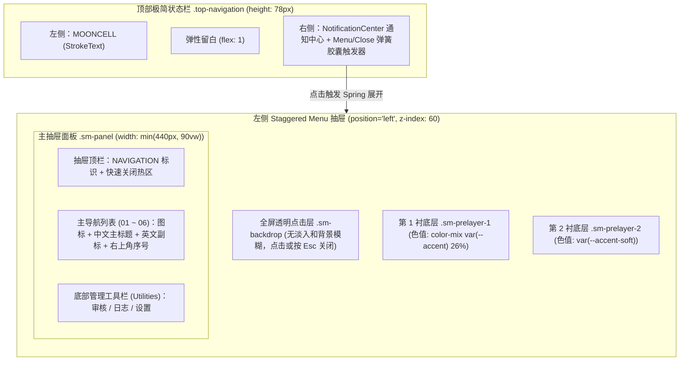

# Mooncell 左侧 Staggered Menu (`position="left"`) 导航设计方案

> 完成状态：已实现并通过类型检查、生产构建与浏览器交互验证（2026-10-22）。

基于您的选择，我们将采用**纯左侧 Staggered 抽屉模式**，搭配**编号 + 图标 + 中英双语大字排版**，并使用 `motion/react` 的 **Spring 物理弹簧动力学**与 **GPU 渲染层隔离**完整重构 React Bits 的 `StaggeredMenu` 组件。

---

## 一、 顶栏与抽屉整体布局架构

> [!IMPORTANT]
> **统一详情页高度契约**：`.top-navigation` 在桌面和移动端均保持 `78px` 高度及渐进模糊背景 `GradualBlur`。实现时同步移除 `index.css` 中旧双行顶栏规则，以及 `show-detail.css` 中移动端 `--detail-header-height: 120px` 的覆盖，保留默认 `78px`，让详情页背景、返回按钮和吸顶页签使用相同高度。

---

## 二、 菜单项排版设计（编号 + 图标 + 中英双语）

抽屉内分为**主导航区（Primary Navigation）**与**底部管理工具区（Utilities）**：

### 1. 主导航区（`01` ~ `06`）
每一项采用 `overflow-hidden` 行容器包裹，内部元素通过 `y` 轴与微倾角 `rotate` 交错弹入：

| 序号 | 路由 | 图标 (`lucide-react`) | 中文主标题 | 英文副标题 (`var(--font-display)`) |
| :---: | :--- | :--- | :--- | :--- |
| `01` | `/` | `LayoutDashboard` | **首页** | `DASHBOARD` |
| `02` | `/shows` | `Tv2` | **番剧** | `ANIME LIBRARY` |
| `03` | `/feeds` | `RadioTower` | **订阅** | `RSS FEEDS` |
| `04` | `/downloads` | `Download` | **下载** | `TRANSFERS` |
| `05` | `/organizer` | `FolderCheck` | **整理** | `ORGANIZER` |
| `06` | `/calendar` | `CalendarDays` | **日历** | `SCHEDULE` |

- **常态与悬停/激活反馈**：
  - 激活态（`isActive`）：左侧显示 `var(--accent)` 指示条，中文标题与右上角编号着色为 `var(--accent)`。
  - 悬停态（Hover）：仅改变文字与图标颜色，不添加位移、卡片底色和阴影。

### 2. 底部管理工具区（对应原版 `socialItems` 槽位）
在抽屉底部以横向图标与文字链接呈现 [`utilities`](file:///f:/code/mooncell/frontend/src/components/app-shell.tsx#L22-L26) 三项工具，不使用胶囊卡片和额外浮入动画：
- **审核** (`/review` · `ListFilter`)
- **日志** (`/logs` · `FileCheck2`)
- **设置** (`/settings` · `Settings2`)

---

## 三、 动效规范（严格遵循三大动效原则）

> [!TIP]
> **拒绝 CSS 线性过渡与布局属性动画**：不动画 `width`、`height`、`top`、`left`、`margin`，所有运动均通过 `motion/react` 在 GPU 合成层 (`transform-gpu`) 上以物理弹簧完成。

| 动效目标 | GPU 变换属性 | Spring 物理参数 (`transition`) | 序列与差速机制 |
| :--- | :--- | :--- | :--- |
| **触发按钮文字轮盘** (`菜单` ⇄ `关闭`) | `y: "0%" ⇄ "-50%"` | `{ type: "spring", stiffness: 400, damping: 30 }` | 随 `open` 状态同步翻转 |
| **触发按钮十字图标** (`+` ⇄ `×`) | `rotate: 0 ⇄ 225, scale: 1` | `{ type: "spring", stiffness: 400, damping: 28 }` | 弹簧过冲带来清脆机械感 |
| **透明点击层** (`.sm-backdrop`) | 无动画 | 无 | 仅用于点击外部关闭 |
| **第 1 衬底层** (`.sm-prelayer-1`) | `x: "-102%" ⇄ "0%"` | `{ type: "spring", stiffness: 440, damping: 34 }` | 展开时最先弹出；收起时最后退回 |
| **第 2 衬底层** (`.sm-prelayer-2`) | `x: "-102%" ⇄ "0%"` | `{ type: "spring", stiffness: 390, damping: 33 }` | 居中差速跟进 |
| **主抽屉面板** (`.sm-panel`) | `x: "-102%" ⇄ "0%"` | `{ type: "spring", stiffness: 340, damping: 32, mass: 0.95 }` | 展开时压轴落位；收起时最先撤离 |
| **主导航项交错** (`.sm-item-inner`) | `y: "110%" ⇄ 0, rotate: 4 ⇄ 0` | `{ type: "spring", stiffness: 400, damping: 30 }` | `staggerChildren: 0.042, delayChildren: 0.08`；以裁切逐项揭示，不淡入 |
| **底部工具项** (`.sm-utility-item`) | 无独立动画 | 无 | 随主面板一起滑入 |

---

## 四、 文件变更计划

1. **新增 [`frontend/src/components/staggered-menu.LICENSE`](file:///f:/code/mooncell/frontend/src/components/staggered-menu.LICENSE)**
   - 保持与项目内 [`branched-menu.LICENSE`](file:///f:/code/mooncell/frontend/src/components/branched-menu.LICENSE) 一致的 React Bits (David Haz) 许可证声明。
2. **新增 [`frontend/src/components/staggered-menu.tsx`](file:///f:/code/mooncell/frontend/src/components/staggered-menu.tsx)**
   - 实现 `StaggeredMenu` 组件（含顶部 `StaggeredMenuTrigger` 胶囊按钮、Portal/Fixed 左侧多层衬底抽屉、编号+图标+中英双语主导航、底部管理工具栏、路由变化自动收起、`Esc` 键关闭、焦点锁定与 `useReducedMotion` 无障碍降级）。
3. **新增 [`frontend/src/components/staggered-menu.css`](file:///f:/code/mooncell/frontend/src/components/staggered-menu.css)**
   - 使用 Mooncell 的主题变量（`--surface`、`--island-border`、`--accent`、`--accent-soft` 等），兼容默认深色主题与 `ocean` 浅色主题；展开面板为实色平面，不使用卡片圆角、阴影或玻璃模糊。
4. **修改 [`frontend/src/components/app-shell.tsx`](file:///f:/code/mooncell/frontend/src/components/app-shell.tsx)**
   - 顶栏左侧为 `MOONCELL` 品牌标志，右侧依次为 `NotificationCenter` 与 `StaggeredMenu` 触发器；移除品牌前的当前页面图标胶囊，抽屉仍从左侧展开。
5. **修改 [`frontend/src/styles/shell.css`](file:///f:/code/mooncell/frontend/src/styles/shell.css)**
   - 精简不再使用的 `.top-links` / `.rail-slider` 样式，优化左侧触发器与 `brand-mark` 的间距对齐。
6. **修改 `frontend/src/index.css` 与 `frontend/src/pages/show-detail.css`**
   - 移除旧顶栏响应式覆盖和详情页移动端 `120px` 高度覆盖；保留通知中心与日历页仍使用的公共样式、溢出测量逻辑。

---

## 五、完成与验证记录

- [x] 左侧 Portal 抽屉、两层衬底、透明点击层及正反差速弹簧动画；按后续调整移除淡入、卡片和浮动效果，仅保留多层交错滑入与文字揭示。
- [x] 六项编号、图标、中英双语主导航与审核 / 日志 / 设置文字工具链接。
- [x] 顶栏菜单轮盘、加号旋转、品牌与通知中心；按后续调整将菜单按钮移至最右侧，并移除品牌前的当前页面图标胶囊。
- [x] 路由变化、点击当前链接、关闭按钮、Esc 与遮罩均可收起；保留修饰键打开链接的默认行为。
- [x] Radix 模态焦点锁定、焦点恢复与页面滚动锁；初始焦点放在短屏下始终可见的关闭按钮。
- [x] 默认深色 / ocean 浅色主题、窄屏 / 短屏滚动及 `useReducedMotion` 降级。
- [x] React Bits 许可证声明与现有 `branched-menu.LICENSE` 一致。
- [x] 前端类型检查、生产构建与 `git diff --check` 通过。构建仍有项目原有的大包体积提示。
- [x] 使用模拟接口的 Edge / Playwright 浏览器回归通过：九个入口、详情子路由高亮、浏览器返回、焦点循环、关闭后恢复、快速开关、通知浮层切换、滚动锁清理及减少动态效果；无页面运行错误。
- [x] 320 / 375 / 600 / 768 / 1023 / 1280 / 1440px 视口下顶栏实测均为 `78px`，无顶栏元素重叠或页面横向溢出；568 × 320 短屏可滚动访问最后一项导航，管理工具保持可见。

本地验证脚本和结果保存在 `.cache/staggered-menu-browser.cjs` 与 `.cache/staggered-menu-browser-result.json`；预览截图为 `.cache/staggered-menu-desktop.png`、`.cache/staggered-menu-ocean-mobile.png` 和 `.cache/staggered-menu-short.png`。
