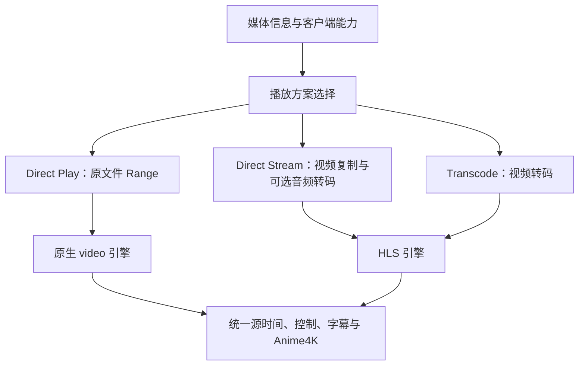

# Mooncell 播放低延迟与快速跳转代码计划

日期：2026-10-23。状态：P0–P3 已实现并完成本轮验证；P4 未通过默认启用门槛；P5 同源软硬编码评估完成，保留现有默认配置。实际结果与验证边界见[本轮验证记录](video-playback-fast-seek-validation.md)。

本计划以当前工作树为基础，包括此前尚未提交的播放器、播放页和加载组件改动；本轮在其上增量实现，未使用 DevSpace 插件。

## 1. 实施结论

推荐顺序：**测量基线 → 优化现有跳转关键路径 → 增加 Direct Play → 增加 Direct Stream → 实验验证按需虚拟 HLS**。

项目已经具备输入端 `-ss`、3 秒 HLS、缓存内跳转、代次隔离和进程回收。当前最有价值的工作是消除进程退出、分片探测和前端轮询的额外等待，并让兼容片源绕过视频转码。完整虚拟 HLS 需要独立解决时间轴、并发请求及播放器兼容性，不能作为前几阶段的前置条件。

借鉴 Emby 的三种播放模式，但不把“扫描阶段一定保存所有关键帧”“固定默认分片时长”或给出的响应毫秒数作为项目事实或性能保证。[Emby 官方播放模式说明](https://emby.media/support/articles/DirectPlay-Stream-Transcoding.html)

两个实现边界：

- 输入端 `-ss` 通常先定位到目标之前的可定位点；转码时仍需解码并丢弃这一小段，流复制则可能保留它。因此必须保留准确时间映射，不能把查到关键帧等同于已经呈现目标帧。[FFmpeg seeking](https://ffmpeg.org/ffmpeg.html#Main-options)
- 常规 HLS 要求清单中的分片可立即下载，VOD 清单发布后不可修改。“完整占位清单＋缺片请求等待转码”应作为经过客户端兼容验证的按需扩展。[RFC 8216 §6.2.1](https://www.rfc-editor.org/rfc/rfc8216.html#section-6.2.1)

## 2. 当前代码与瓶颈

| 位置 | 当前行为 | 优化方向 |
| --- | --- | --- |
| `backend\app\playback\transcode.py:28` | 已有输入端快进；TS 预回退 30 秒后准确 trim | 沿用正常快进路径，按容器制定有预算的定位策略 |
| `backend\app\playback\sessions.py:447` | 首片时间偏晚后设置 `linear_seek`，后续可能从头解码；标记在会话中保留 | 移除静默、无耗时预算的线性退化；每次定位独立记录尝试与失败原因 |
| `backend\app\playback\sessions.py:243` | 持全局锁等待旧 FFmpeg 退出 | 改成每会话串行调度；进程等待移到全局锁外 |
| `backend\app\playback\processes.py:138` | 停止依次具有 3 秒、2 秒、5 秒超时预算 | 区分 seek 替换和正常关闭策略；超时预算不等于每次实际耗时 |
| `backend\app\playback\sessions.py:422` | 每 250ms 监控，逐个外部 ffprobe 读取 TS 首视频 PTS 后才登记 | 首片就绪通知、减少重复探测；保留真实时间戳校验 |
| `backend\app\playback\sessions.py:151` | 全局锁内递归计算缓存容量 | 增量记账，低频核对磁盘真实占用 |
| `frontend\src\hooks\use-playback-session.ts:133` | 状态每 1500ms 轮询 | 准备期使用状态版本与有界等待，首帧不依赖下一轮固定轮询 |
| `frontend\src\components\player\player.tsx:279` | 浏览器本地 seek 成功后仍无条件进入控制 seek/定位状态 | 区分浏览器缓冲、服务端缓存和缺片三条路径 |
| `frontend\src\lib\player\hls-engine.ts:85` | 首片缓冲后仍需匹配会话返回的分片源时间 | ready 响应携带可直接使用的首片映射 |
| `backend\app\playback\probe.py:271` | 已有内存/数据库缓存及并发探测合并；仍以首次播放触发为主 | 统一持久化入口，增加后台预热和探测 schema 版本 |
| `backend\app\playback\transcode.py:51` | 所有视频都转为 H.264，所有音频转 AAC | 按兼容性选择原文件、流复制或完整转码 |

目前选择 NVENC 只代表硬件编码，现有普通 `scale` 和解码并不因此自动成为全 GPU 管线。

## 3. 目标结构与协议



建议新增 `backend\app\playback\planner.py` 与前端 `PlaybackEngine` 接口，将模式选择和媒体传输实现从 UI 中分离。

| 契约 | 计划变化 |
| --- | --- |
| `PlaybackInfo` | 补容器、视频 profile/level、像素格式/位深、码率、源起始时间等信息；持久化带 `probe_schema_version` |
| 创建会话 | 增加受限的客户端能力、模式偏好、原画/自动意图及码率约束；保留现有数字清晰度请求的兼容语义 |
| 会话响应 | 增加 `playback_mode`、`mode_reason`、`stream_url`、`mime_type`、`timeline_mode` 与单调递增 `revision` |
| seek 请求/响应 | 保留幂等请求 ID、代次检查；增加 seek 序号、目标及处理结果，明确是否需要重载媒体源 |
| 状态查询 | 在现有 GET 上增加 `after_revision` 和受限 `wait_ms`，状态变化后立即返回；超时仍返回当前状态 |
| 原文件传输 | 新增会话与 generation 下的鉴权 `stream` GET/HEAD，URL 由后端生成 |

客户端能力由 `canPlayType`、MSE 能力和可用时的 MediaCapabilities 综合获得，服务端采用已验证的兼容矩阵。不能只凭浏览器名称或 `h264/hevc` 名称决定直放。播放失败最多进行有限次降级，并保留源时间、暂停状态和用户选择。

“原画”与指定 720p/1080p 必须区分；选择了真实缩放或码率上限时，不能为追求直放而悄悄忽略约束。首轮保持现有 SDR 支持范围，HEVC/HDR 等按模式和浏览器另行验收。

## 4. 分阶段代码工作

### P0：建立可比较的性能基线

修改 `sessions.py`、`processes.py`、`transcode.py`、`use-playback-session.ts`、`hls-engine.ts`、`player.tsx`；新增 `scripts\benchmark_playback_seek.py` 记录服务端与媒体样本结果，浏览器部分记录真实呈现数据。

- 以同一个 seek ID 串联：用户提交、服务端接收、旧进程退出、启动新进程、首片封口、PTS 确认、首片返回、目标帧呈现。
- 前端以 `performance.now()` 计时，优先用 `requestVideoFrameCallback` 的 `mediaTime` 校验最新目标帧；暂停跳转同样验帧。
- 区分原生 video 呈现与 Anime4K 目标帧提交 Canvas 的时间；`seeked`、`FRAG_BUFFERED`、HTTP 200 均只作为中间指标。
- 浏览器缓存、服务端缓存、冷重封装、软件转码、硬件转码分别统计 P50/P95、失败率和资源占用。探测冷缓存与热缓存分开记录，客户端和服务端各自使用单调时钟，不直接相减两端时钟。

交付：固定片源、机器、浏览器、网络及编码器的基线报告；用结果确认后续性能门槛。

### P1：先改善现有 HLS 跳转

后端修改 `sessions.py`、`processes.py`、`cache.py`、`transcode.py`、`session_router.py`：

1. 使用每会话串行调度与短全局资源登记锁。停止/启动进程、等待 ready、磁盘核对均不持有全局锁。异步结果校验当前 generation 和生产尝试 ID；旧任务不得释放新任务的租约。
2. 为 seek 替换增加短宽限停止策略，确认旧进程退出并释放编码槽后启动最新目标。正常关闭保留完整清理；连续拖动只调度最后一个有效目标。
3. 为每代次添加 ready 通知和状态 revision。首片完成时间戳校验即通知状态等待者，返回首片 sequence 与源时间；稳定播放再降低状态查询频率。
4. 先保留首片实际 PTS 探测。测量后选择轻量 TS 时间戳解析，或经连续性验证后由首片锚点和实际分片信息推导后续映射；不直接删除所有 ffprobe。
5. 将 `linear_seek` 替换为每次定位独立的策略：索引跳转、有限向前回退、预算耗尽后明确失败或受控兼容降级。无索引、损坏索引和超长 GOP 单列，避免静默从头处理整片。
6. 缓存改为增量计账并保留低频磁盘核对、最低可用空间检查、分片原子发布、reader 引用保护和配额限制。

前端修改 `player.tsx`、`hls-engine.ts`、`use-playback-session.ts`、`types.ts`：

1. `seek()` 从 boolean 改为 `buffered / server-cache / miss`。本地缓冲命中立即展示目标帧，不因位置确认遮挡画面；服务端缓存命中保留引擎并按需取片；缺片才进入重建流程。
2. 本地跳转仍通过轻量位置确认更新服务端时钟。不能直接删除控制请求，现有心跳会拒绝超过 15 秒的不连续位置。浏览器缓冲还在、服务端片段已淘汰时，确认位置不强制清空本地数据；后续供片确需切流时显式返回重载决定。
3. 使用 `{sessionId, generation, seekId, target}` 隔离旧回调。目标首帧确认前，旧 `timeupdate`、`onReady` 和 `play()` Promise 不得覆盖目标位置或 UI。
4. 消除首片时间映射对固定 1500ms 轮询的依赖，保留取消、StrictMode、页面隐藏及旧响应隔离。
5. 沿用当前实际状态驱动的启动 loading 组件；跳转结束依据目标帧，避免以动画时长决定就绪。

本阶段保留 3 秒常规分片作为基线。只有测量证明首片封口占主导后，再实验较短初始分片并同步关键帧策略。`hls_init_time` 本身仍受关键帧约束。[FFmpeg HLS muxer](https://ffmpeg.org/ffmpeg-formats.html#hls-2)

验收：缓存命中无多余重建；首片就绪不等待整轮状态轮询；连续拖动只最后目标生效；其他会话心跳和资源释放不被旧进程退出阻塞。

### P2：能力协商、后台预热与 Direct Play

新增 `planner.py`、`direct.py`、`frontend\src\lib\player\engine.ts` 和 `native-engine.ts`；修改探测/schema/路由/会话管理、前端 API 类型和播放器工厂。

- 第一批覆盖 MP4/H.264 SDR/AAC 的已验证组合，受所选音轨、分辨率和码率限制。原生 video 还必须能可靠选择用户指定的文件内音轨；无法选择时使用 Direct Stream，不能只判断音频编码兼容。其他片源回到现有 HLS。
- 原文件响应支持 HEAD、Range、206、416、Content-Range、文件版本 ETag/If-Range；优先复用项目安装版本中经过测试的 FileResponse 能力。
- 全程复用鉴权、路径检查、文件版本检查与读取租约；ASGI 响应的 finally 负责断连释放，传输不占用数据库事务。
- Direct Play 的视频传输路径不启动 FFmpeg、不生成分片、不占视频转码槽；内嵌字幕冷缓存提取单独计量。逻辑会话和网络传输仍有限额，并继续保存进度。
- 独立定义原生媒体时间到源时间的映射，覆盖 MP4 非零起点及 edit list；不能直接假定所有 `currentTime` 都等于源时间。
- 在媒体登记或下载整理完成后低优先级预热元数据，复用现有探测合并和并发限制；播放请求具有更高优先级，扫描接口不等待探测。
- 把探测持久化从单个 playback-info 路由抽出，新增 schema 版本与失败退避；已有数据库无需为同一媒体重复探测。
- 字幕按媒体版本、轨道和外置字幕自身版本缓存，解绑转码 generation。SRT/WebVTT 继续独立渲染，ASS/PGS 不在本轮扩展。

验收：兼容片源的视频传输不启动 FFmpeg，实际音轨与用户选择一致，字幕缓存命中后跳转不重复提取；Range 返回字节正确；断连、文件替换、迁移和认证失效均能正确回收。

### P3：Direct Stream 视频流复制

拆分 `transcode.py` 为转码与重封装命令构造，扩展 `planner.py`、会话资源统计和 HLS 时间映射。

- 视频无需改变且客户端可解码时使用 `-c:v copy`；音频按兼容性选择 copy 或 AAC。
- 流复制命令移除视频 `trim/scale`、编码码率、强制关键帧等转码专用选项；通过目标之前的随机访问点定位，再让客户端定位到准确目标。
- 实际分片边界由源随机访问点决定，采用真实时长，不能承诺严格每 3 秒。开放 GOP、长 GOP 或不可独立解码样本按验证结果回退。
- 沿用有限窗口 HLS 和现有 generation 保护，先独立交付流复制；不等待虚拟 HLS 完成。
- 分别限制逻辑会话、重封装任务和视频转码任务；音频转码仍计入相应资源预算。

验收：视频流未经重编码；独立分片可解码；准确目标呈现、字幕、音频边界与同步正常；大幅前后跳转无需顺序生产中间全部内容。

### P4：按需虚拟 HLS 实验与是否启用的判定

新增 `timeline.py` 和分片调度模块；扩展 `cache.py`、`sessions.py`、`session_router.py`、前端 HLS loader。通过配置开关启用，现有窗口 HLS 为回退方案。

1. 先用真实片源验证全局时间轴。转码采用可重复的边界/GOP 规划，覆盖 23.976/29.97 fps、VFR、AAC priming、非零起始与尾片；不能直接将当前 seek 相对输出套进 `floor(time / 3)`。
2. 流复制若需要完整清单，必须先得到可靠的随机访问点与变长片段映射。普通元数据探测不保证得到完整索引，扫包工作需后台限并发、限耗时，不进入即时播放关键路径。
3. 区分公开表示 generation、最新控制 seek ID 与内部生产 job epoch。质量/轨道/表示变化更新 generation；同表示内 seek 可换 job epoch。心跳和进度写入也校验最新控制 ID，防止同 generation 内旧目标覆盖新目标。稳定 generation 内保持可拼接的 PTS/DTS 与固定映射，否则继续采用新 generation 切流。
4. 稳定分片键包含文件版本、表示参数、时间轴版本与全局序号。job 先写独立临时目录，验证仍有效后原子发布；已发布分片不可被旧 job 或另一任务覆盖。
5. 每个分片共享 Future/Event；同一会话只保留受控生产任务。请求等待位于锁外，有超时、断连取消、失败和关闭唤醒，不能无限挂起。
6. 最新显式 seek 意图决定生产优先级。旧预取、重试和并行 GET 不得仅因距离较远反复触发进程重启；相邻分片请求合并生产。
7. 完整清单中的有效分片被淘汰后必须可重建；前端针对缺片等待的超时和重试必须与服务端预算一致。不能把普通 404 当作正在生产的常态。
8. 保持同一前端媒体管线的前提是时间戳连续且可验证；当前只建立一次 anchor 的 HLS 引擎需相应升级。原生 Safari HLS 另行验收。

启用条件：相同片源与环境下，冷跳转 P95 或交互连续性优于 P1–P3，且没有请求反复重启、时间漂移、缺片超时和无界缓存增长。未满足条件时保持现有输入快进方案，仍可取得前三阶段收益。

### P5：按实测需要优化硬件管线

如果 P0–P4 的分解数据表明解码/缩放/编码占主要耗时，再为目标 NVENC/QSV 设备增加硬解与设备侧缩放方案，先做实际编码自检，并保留一次软件回退。比较 `-readrate 8` 和短时起播加速策略时，仍保留磁盘配额和生产水位。

该阶段不将编码器名称等同于整条 GPU 管线；保留已有 Windows Job Object、Linux 父进程退出回收与单 worker 约束。

## 5. 验证与交付边界

计划阶段曾在 `frontend` 目录运行现有前端专项基线，36/36 通过；实施后的测试与性能结果另记在验证文档：

```powershell
node --test tests\hls-engine.test.cjs tests\playback-session.test.cjs tests\player-startup.test.cjs
```

该历史基线不代表端到端跳转延迟已经达标。本轮已实现直放与流复制，并使用独立数据库和合成媒体验证；未验证的浏览器和片源范围仍按实际结果列出。

后续验收矩阵：

| 类别 | 必须覆盖 |
| --- | --- |
| 定位 | 浏览器缓冲、服务端缓存、未生成区域；前跳、后跳、暂停跳转、尾部与连续至少 20 次拖动 |
| 时间戳 | 长时间轴、长 GOP、开放 GOP、VFR、非零起点 TS、AAC priming、多音轨与无音轨 |
| 正确性 | 目标源时间误差、声画同步、字幕同步、旧回调隔离、暂停/倍速/音量保留 |
| 传输 | Range 字节准确性、HEAD、416、If-Range、认证失效、请求断开、慢网与慢磁盘 |
| 生命周期 | 旧 FFmpeg 无响应、两会话并行、硬编失败回退、读取中迁移/替换、关闭与父进程异常退出 |
| 资源 | 编码槽、remux 槽、缓存配额、句柄/reader 保护、长播无持续增长 |

每个性能场景至少重复 30 次，记录 P50/P95、最大值、失败率及重启次数；绝对秒数在固定基准后确定。可先将浏览器缓存内 P95 低于 200ms、局域网兼容直放低于 500ms、已预热硬件转码冷跳转低于 1.5s 设为候选目标，异常索引与冷探测单列，不混入“秒跳”宣传。

实现按 P1、P2、P3、P4 拆分交付，每一步完成相关 pytest、前端行为测试、类型检查/构建及真实浏览器验帧，再推进下一步。虚拟 HLS 的默认启用取决于独立实验结果。

开发服务继续从项目根目录通过固定入口启动，并遵守 `AGENTS.md` 的权限流程：

```powershell
powershell.exe -NoProfile -File F:\code\mooncell\scripts\dev.ps1
```
