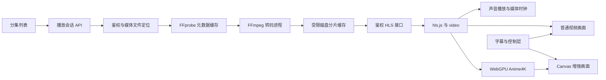

# Mooncell 在线播放与 Anime4K 开发计划

日期：2026-10-20。状态：P0–P5 首版功能已实现；Windows Chrome 与 Linux/Docker 主要链路、30 分钟浏览器播放及 NVENC 持续编码已验证。其他浏览器与真实局域网 HTTPS 仍待验收，尚不宣称下文全部兼容条件均已通过。具体执行结果见[交付验证记录](video-playback-validation.md)。

目标：从媒体库分集列表进入播放页，通过 Python 后端调度 FFmpeg 实时转码、HLS 分片传输，在浏览器内播放；按需启用客户端 Anime4K 画面增强。

## 1. 已确定的方向与首版范围

| 项目 | 开发决定 |
| --- | --- |
| 后端 | 沿用 FastAPI，FFprobe 探测媒体，FFmpeg 独立子进程转码 |
| 传输 | 同源、带 Cookie 鉴权的 HLS 清单及分片接口 |
| 前端 | React 自定义播放器，底层使用 `<video>` 和 hls.js |
| 画面增强 | 客户端 WebGPU 执行 Anime4K，Canvas 显示结果 |
| 播放入口 | 点击本地分集，进入独立 `/watch/:mediaId` 播放页 |
| 主要验收环境 | Windows Chrome、Edge；普通播放兼容性另测 Firefox、Safari |
| 输出格式 | 首版 H.264、8-bit SDR、AAC 双声道；无音轨文件允许纯视频播放 |
| 输出清晰度 | 720p、1080p，保持比例；不超过源视频尺寸，不在服务器放大画面 |
| 编码器 | 先建立软件编码基线和统一接口，再接实际部署设备可用的硬件编码器 |
| 增强开关 | 默认关闭，提供轻量、标准档，记住当前设备的选择 |
| 基础体验 | 全片进度条、拖动、暂停、音量、倍速、全屏、选集、续播、错误恢复 |
| 基础字幕 | 支持外置和内嵌的 SRT/WebVTT，独立字幕层；烧录在原画面中的字幕自然保留 |

第一版不包含多码率自动切换、服务器端 Anime4K、跨用户共享转码任务、离线下载、DRM、增强画中画。ASS/SSA 特效字幕、PGS 图片字幕和 HDR 色调映射列入后续扩展；遇到这些格式应明确显示支持状态，不能默默丢失字幕样式或按普通 SDR 输出错误颜色。

用户不需要安装浏览器扩展。首版默认执行实时转码；原文件直放和仅重新封装可在后续作为性能优化加入。

## 2. 与现有项目的衔接

| 现有位置 | 当前能力 | 计划调整 |
| --- | --- | --- |
| `backend\app\show_library.py` | 按实际文件扫描季度与分集，返回相对路径、大小和修改时间 | 增加文件身份关联，保持普通扫描轻量 |
| `backend\app\api.py` | `/shows/{source_id}/library` 及缩略图接口 | 分集返回 `media_id`；播放接口放入独立模块 |
| `backend\app\dependencies.py` | Cookie 登录认证 | 播放会话、清单、分片、字幕全部复用认证 |
| `backend\app\main.py` | lifespan 管理后台任务 | 注册播放路由、回收任务及退出清理 |
| `frontend\src\components\show-episode-list.tsx` | 展示本地分集 | 增加播放入口和观看进度 |
| `frontend\src\app.tsx` | 路由、应用壳、全局动态背景 | 添加独立播放页，播放时停用全局动态背景，减少 GPU 竞争 |
| `frontend\src\lib\api.ts` | 同源 JSON 请求 | 控制请求复用；HLS 和字幕资源直接使用同源媒体 URL |
| `frontend\vite.config.ts`、`frontend\nginx.conf` | `/api` 同源代理 | 沿用代理，补充媒体响应与 HTTPS 部署验证 |
| `backend\Dockerfile` | Alpine、Python、ImageMagick | 安装 FFmpeg/FFprobe，验证编码器、字体和缓存目录权限 |

本机 FFmpeg/FFprobe 7.1 已完成真实转码、时间戳和进程回收验证；Docker 镜像已安装 FFmpeg，并通过 Linux API/HLS 集成测试。软件编码为默认基线，硬件结果见[进程验证](video-playback-p0-process.md)与[硬件验证](video-playback-hardware.md)。

当前 React 启用 StrictMode。播放器、会话请求和渲染器初始化必须支持重复挂载、取消与清理。

## 3. 播放架构



Python 负责会话、进程和文件传输，不把视频解码成 Python 图片再逐帧发送。前端收到压缩音视频，由浏览器解码，Anime4K 只处理当前视频画面。

### 完整时间轴与跳转

采用“全片业务时间轴 + 有限窗口 HLS + 播放代次 generation”的首版方案：

1. FFprobe 提供全片时长，前端进度条始终显示完整影片。
2. 当前 generation 对应一次连续 FFmpeg 输出；后端维护源文件时间与媒体播放时间的映射锚点。
3. 已缓存且仍可播放的区间可以直接定位。
4. 跳转到窗口外时，发送目标源时间，终止旧转码并创建新 generation，从目标附近关键帧开始读取并准确转码。
5. 新 generation 使用独立资源地址；旧控制请求、旧网络响应和旧字幕回调不能覆盖新状态。
6. 前端显示“正在定位”，首帧就绪后恢复原暂停/播放状态、倍速和音量。

全片进度、字幕和观看记录统一使用源文件时间。映射形式为 `源时间 = 源锚点 + 媒体时间 - 媒体锚点`；锚点必须通过实际输出时间戳验证，不能简单假设每次 `video.currentTime` 都从零开始。滚动清单移除旧分片时，时间轴不得跳变。

这里使用普通滚动 HLS 清单。FFmpeg 的 EVENT 清单只允许追加，VOD 清单必须保持不变，不能同时套用这两种类型并删除清单中的历史条目。[FFmpeg HLS 文档](https://ffmpeg.org/ffmpeg-formats.html#hls)

P0 必须验证 hls.js 在该模式下不会自动跳到直播边缘、偷偷加速追赶或在暂停恢复时丢失用户位置。原生 HLS 回退需要单独通过这些测试后才启用。若该方案不能稳定实现点播行为，在 P0 改用虚拟 VOD 清单与按需分片调度，并重新验证跨批次音视频时间戳；不得把只可跳转到已转码区间的实现当作完成。

### 后端转码背压与缓存

前端缓冲限制、磁盘缓存限制和转码领先量是三件事，需要分别实现。

- 当前 generation 保持一个连续 FFmpeg 进程，避免不断重启编码造成音频衔接问题。
- 通过 FFmpeg 进度输出、已完成分片时间和前端播放位置计算领先量；位置必须受时长、generation 和状态约束。
- 达到高水位后暂停本服务创建的 FFmpeg，低于低水位再恢复。拟使用 psutil 的跨平台进程暂停/恢复，先做 Windows 与 Linux 验证。
- 暂停播放时停止继续生成；短暂停留保留进程，长暂停释放进程，恢复时按保存位置创建新 generation。
- 暂停中的进程不能误判为“转码卡死”；退出前先恢复，再尝试正常关闭，超时后强制终止并等待退出。
- 挂起的进程仍占内存及硬件编码资源，继续计入并发上限；编码线程数、输出码率和诊断日志尾部均设上限。持续读取 FFmpeg 输出，防止管道填满。
- 分片完整落盘并原子发布后才允许读取；缓存清理不能删除正在写入、发送或仍在请求宽限期内的文件。
- 同时限制单会话字节数、全局字节数和最低磁盘余量。超限时回收可删除缓存；仍不足则暂停/拒绝新任务并返回可理解的错误。
- 配额与水位预留在写分片和检测延迟的余量；不足以生成下一个分片时停产，不能靠删除仍需播放的数据腾空间。

psutil 在 Windows 上可以挂起和恢复进程线程；UNIX 使用对应的停止/继续信号。跨平台退出语义不同，必须由专门的进程管理模块封装。[psutil 进程控制文档](https://psutil.readthedocs.io/en/latest/#psutil.Process.suspend)

以下为初始调优值，不作为未实测的性能承诺：

| 参数 | 初始值 |
| --- | --- |
| HLS 分片目标时长 | 约 3 秒，关键帧对齐，使用实际分片时长 |
| 前端前向缓冲 | 目标约 30 秒，另设时长上限 |
| 前端后向缓冲 | 约 30 秒 |
| 后端转码水位 | 领先约 90 秒暂停，降到约 30 秒恢复 |
| 后端历史分片窗口 | 约 60 秒，另留正在读取分片的宽限 |
| 单会话 / 全局缓存配额 | 512 MiB / 4 GiB，可配置 |
| 同时转码数 | 默认 1，可按硬件测试结果调整 |
| 心跳 / 失联回收 | 约 15 秒 / 120 秒；有效分片访问也计为活跃 |
| 长暂停释放进程 | 约 60 秒；暂停页仍可保留逻辑会话和位置 |
| 已结束会话缓存清理 | 约 10 分钟；硬配额压力下可提前清理 |

HLS 缓冲参数需要显式配置并测试，不能把一个参数视为浏览器整体内存的硬限制；浏览器还可能使用 HTTP 缓存。初版媒体接口使用 `Cache-Control: no-store`，不添加 Service Worker 离线缓存。[hls.js 配置说明](https://github.com/video-dev/hls.js/blob/master/docs/API.md)

## 4. 数据与接口草案

新增 `MediaFile`，保存媒体 ID、订阅源 ID、相对路径、文件版本及探测结果。文件版本由路径、大小和高精度修改时间组成；首次播放时探测，版本变化时失效，避免每次分集列表刷新都执行 FFprobe。扫描可批量更新文件身份，不把“列表中存在”当成文件始终可读的保证。

新增 `PlaybackProgress`，按用户和媒体 ID 保存源时间、时长、更新时间与看完状态。文件改名或迁移的自动身份匹配另行扩展，首版不能仅凭相同文件名复用进度。

播放会话及进程句柄暂由单个后端 worker 管理，重启后创建新会话并从持久化进度恢复；不恢复旧 PID。初版部署明确限制单 worker，多 worker 需要后续独立任务管理服务。

接口统一位于 `/api/v1`：

| 方法与路径 | 用途 |
| --- | --- |
| `GET /media/{media_id}/playback-info` | 获取版本、时长、音轨、字幕、可选输出档位与支持状态 |
| `POST /playback/sessions` | 提交媒体 ID、起播时间、档位和音轨；幂等创建会话 |
| `GET /playback/sessions/{id}` | 查询准备状态、generation、时间锚点、缓存区间及错误 |
| `POST /playback/sessions/{id}/seek` | 提交目标源时间及当前 generation，重建播放代次 |
| `PATCH /playback/sessions/{id}/options` | 切换清晰度或音轨，保留源时间并重建代次 |
| `POST /playback/sessions/{id}/heartbeat` | 更新播放位置、倍速、暂停状态与活跃时间 |
| `DELETE /playback/sessions/{id}` | 幂等停止会话并回收进程 |
| `GET /playback/sessions/{id}/{generation}/index.m3u8` | 获取当前滚动播放清单 |
| `GET /playback/sessions/{id}/{generation}/segments/{name}` | 获取服务端生成并登记的完整分片 |
| `GET /media/{media_id}/subtitles/{track_id}` | 获取鉴权字幕资源 |
| `GET /media/{media_id}/progress`、`PUT /media/{media_id}/progress` | 获取或保存观看进度 |
| `GET /settings/playback/capabilities` | 查看 FFmpeg、编码器与服务器播放能力 |

创建接口返回会话 ID、`preparing` 状态和状态地址；首个有效播放清单就绪后返回 `ready`、播放 URL、全片时长及时间映射。不要让 JSON 请求一直等待整段转码。

会话状态包含 `preparing / ready / paused / failed / closed`；内部进程状态另外区分运行、因水位暂停、因用户暂停、已退出。资源耗尽、探测失败、编码器失败、文件不可读和会话失效应有不同错误码。

所有资源接口校验当前用户和会话归属。客户端只提交媒体 ID、轨道 ID和受限参数，不提交服务器绝对路径、任意 URL 或 FFmpeg 参数。文件定位必须落在配置的媒体库与作品目录内，拒绝越界、符号链接、Windows junction、设备路径和 ADS 路径；启动前重新检查文件版本及迁移状态。FFmpeg 以参数数组启动，并限制输入协议。

当前季度迁移、修订版升级会移动或替换视频。播放会话应登记正在使用的文件，自动迁移在文件使用期间延后，并向现有任务状态报告原因；释放后再重试。迁移开始后拒绝针对旧位置创建新会话，避免 Windows 文件锁和路径变化竞态。鉴权完成后及时释放数据库事务，分片传输不长期占用数据库连接。

## 5. 前端播放器与 Anime4K

建议拆分为以下模块：

| 新增模块 | 职责 |
| --- | --- |
| `frontend\src\pages\watch.tsx` | 独立播放页、作品标题、返回入口、选集 |
| `frontend\src\components\player\player.tsx` | video、canvas、字幕、控制栏的组合容器 |
| `frontend\src\components\player\player-controls.tsx` | 全片时间轴、音量、倍速、全屏、档位和增强开关 |
| `frontend\src\hooks\use-playback-session.ts` | 创建、跳转、心跳、错误恢复和销毁 |
| `frontend\src\lib\player\hls-engine.ts` | HLS 加载、网络错误处理、缓冲、时间映射 |
| `frontend\src\lib\player\anime4k-renderer.ts` | WebGPU 能力检测、渲染调度、预设切换和资源释放 |
| `frontend\src\components\player\subtitle-overlay.tsx` | 按源时间显示字幕，覆盖普通和增强画面 |

视频仍负责音频和媒体时钟。关闭增强时显示 video；开启时显示同一容器内的 Canvas，音频、进度和控制继续由同一 video 管理。

`anime4k-webgpu` 作为候选算法依赖，P0 验证后锁定版本。其现有 `render()` 封装没有完整的取消/销毁接口，不能直接照搬示例；需要自有渲染循环及可释放资源的适配，必要时维护带许可证的最小补丁。[项目说明](https://github.com/Anime4KWebBoost/Anime4K-WebGPU)、[渲染器源码](https://github.com/Anime4KWebBoost/Anime4K-WebGPU/blob/main/src/renderer/index.ts)

必须覆盖以下行为：

- 检查安全上下文、WebGPU、adapter 和 device；不可用时保留普通播放并解释增强不可用原因。
- 使用视频帧回调调度，暂停、切集、切档位和卸载时取消旧回调；异步初始化结束后也要检查实例是否已失效。
- 释放纹理、缓冲、监听器和观察器；处理 GPU device 丢失及资源重建。
- 分辨率、容器尺寸和全屏变化时更新输出尺寸；限制 DPR 和最大输出像素，避免无意义的 GPU 开销。
- 暂停状态拖动或切换增强时，也能更新当前静态画面。
- 在标准档持续超出帧预算时降到轻量，再降到关闭；给出一次简短提示，避免反复自动切换。
- 字幕和控制栏置于独立覆盖层；全屏作用于整个播放器容器。
- 首版仅在实测可用时开放普通视频画中画，并明确增强画面与外置字幕不会自动随原 video 进入画中画；增强画中画后续实现。
- 播放页按需加载 HLS/Anime4K，停用背景 GPU 动画，保留键盘操作、焦点与可访问的滑块。

局域网设备使用 WebGPU 需要可信 HTTPS；本机 `localhost` 可利用安全上下文例外。现有 HTTP 部署应提供 HTTPS 配置指引，不要求用户关闭浏览器安全限制。[WebGPU 文档](https://developer.mozilla.org/en-US/docs/Web/API/WebGPU_API)

## 6. 分阶段实施与验收

### P0：验证关键链路

使用短测试片和代表性本地番剧，完成最小 HLS、进程背压和 Anime4K 原型。测试覆盖 MP4/H.264、MKV/HEVC、无音轨、不同帧率，以及 720p/1080p SDR。

- 验证从开头起播、跳到尚未生成的位置、向后跳出缓存、暂停后恢复。
- 验证全片时间轴、音画同步、滚动清单时间映射，播放器不自动追直播边缘。
- Windows/Linux 验证 FFmpeg 暂停/恢复、关闭与父进程异常退出后的回收。
- 验证 HLS 与 Anime4K 共用 video，切换增强不重置播放进度。
- 验证 StrictMode 重复挂载及多次切集后没有多余会话、渲染循环或持续增长的 GPU 资源。
- 记录软件编码基线、硬件候选、起播时间、跳转等待和增强帧耗时。

交付：技术验证记录、确认的 HLS 时间映射与背压方案、锁定的前端依赖和兼容环境。上述链路通过后再进入正式模块实现。

### P1：媒体身份、探测与播放协议

实现媒体 ID、按文件版本缓存的 FFprobe 元数据、播放 schema、文件定位和能力接口。探测有超时、并发限制和取消能力，不阻塞 RSS、下载队列与 API 主循环。

验收：同一文件重复查询复用结果；文件替换后失效；跨目录路径与未登录请求被拒绝；没有 FFmpeg 或编码器不可用时给出明确状态。

### P2：可管理的实时转码后端

实现会话管理、FFmpeg 参数生成、HLS 分片服务、时间锚点、seek 代次切换、背压、缓存配额和回收。

建议新增 `backend\app\playback\`，按 `router.py / schemas.py / media.py / probe.py / sessions.py / transcode.py / processes.py / cache.py` 拆分。

退出清理需要覆盖正常退出、热重载和异常父进程退出；Windows Job Object 等平台机制在 P0 选型，不能仅依赖 Python `finally`。启动清理只处理任务自有缓存，不按进程名终止其他 FFmpeg。

验收：可独立创建会话和读取分片；快速连续 seek 合并请求并只保留最新代次；暂停时停止继续生成；退出后无残留进程；缓存配额生效且不破坏正在读取的分片；播放与文件迁移、替换不会互相破坏。

### P3：普通播放器和基础字幕

增加分集入口、独立播放页、完整控制栏、会话状态和错误提示；实现选集、清晰度、音轨和 SRT/WebVTT 字幕切换。字幕时间与源时间一致，切集后及时清理旧字幕。

验收：完整观看一集，任意位置跳转，切集、返回、全屏、倍速正常；弱网显示缓冲并有限重试；认证过期停止重试；字幕始终与画面对应。对原生 HLS 的支持以专项测试结果为准。

### P4：Anime4K 增强

接入已验证的可销毁适配层，实现轻量/标准预设、尺寸管理、性能降级与设备偏好。字幕覆盖层同时服务普通和增强画面。

验收：开启/关闭不重建转码会话；音频和进度连续；窗口/全屏切换后比例正确；暂停拖动更新画面；无 WebGPU、GPU 丢失或性能不足时可继续普通播放。

### P5：续播、硬件加速与交付

实现观看进度持久化、继续播放与播完处理；定期及暂停时保存进度，关闭页面时尽力提交，服务端不依赖关闭事件回收任务。

接入目标环境可用的 NVENC/QSV/AMF 等编码器；先做实际编码自检，不能只根据 `-encoders` 列表判断可用。失败时提供有限的软件回退或降档，避免无限重试和无提示的卡顿。

补齐 Docker FFmpeg、缓存卷、单 worker 约束、硬件映射说明和 HTTPS 文档。转码任务始终有全局并发上限。

验收：刷新或重开页面能续播；跨代次进度不被旧请求覆盖；Windows 开发与 Docker 普通播放通过；目标硬件完成持续转码测试；HTTPS 下增强可用，HTTP 局域网下准确回退。

## 7. 测试与完成标准

| 层次 | 重点验证 |
| --- | --- |
| 后端单元/接口测试 | 鉴权归属、文件边界、探测失效、代次竞态、错误状态、配额与清理 |
| 真实 FFmpeg 集成测试 | 合成音画同步样本、首帧、关键帧定位、音轨、分片完整性、暂停恢复、进程退出 |
| 前端行为测试 | 初始化取消、连续 seek、全片时间映射、字幕偏移、卸载清理、错误降级 |
| 浏览器人工验收 | 实际播放、全屏、选集、弱网、暂停、切档位、增强效果与兼容性 |
| 稳定性测试 | 连续播放至少 30 分钟，多次切集/开关增强，内存、显存、磁盘和进程数不持续失控 |

选定基准机器和样本后，记录 P0 实测值并确定性能门槛。初始目标：本地/局域网普通 1080p 起播约 5 秒内、未缓存跳转约 5 秒内；增强持续处理时间低于对应帧预算；合成样本音画偏差控制在约 100 ms 内。这些目标不能解释为对任意片源、网络或 GPU 的保证。

前端新增少量状态与生命周期测试，后端沿用 pytest；不为计划文档或静态布局单独添加测试。

开发启动继续使用项目固定入口：

```powershell
powershell.exe -NoProfile -File F:\code\mooncell\scripts\dev.ps1
```

遇到现有 Windows 沙箱权限问题时遵循 `AGENTS.md` 的正式授权流程。依赖通过 pnpm 安装；功能交付时执行相关后端测试、静态检查、前端构建及真实浏览器播放验收。

完成定义：P0 至 P5 全部通过，用户能从媒体库点击真实视频播放、任意跳转、切集和续播；支持的设备可开启 Anime4K；失败时有可恢复的状态；关闭播放器后服务端和前端资源可回收。仅展示视频画面或只完成某个接口不算交付。
