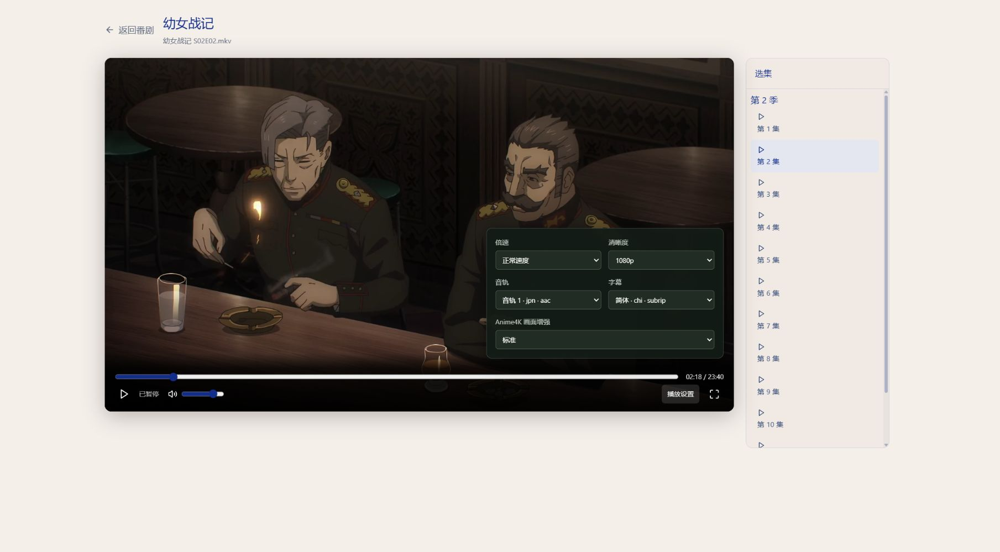
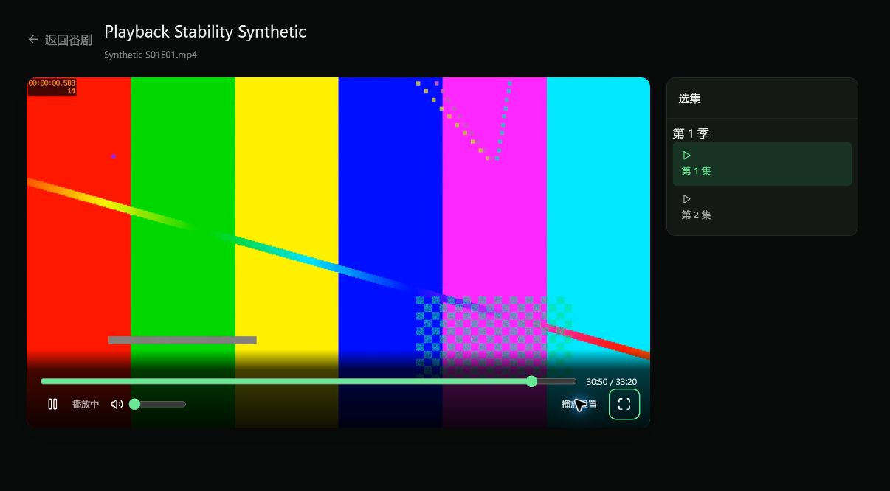

# 在线播放交付验证记录

日期：2026-10-20。首版功能及主要环境验收完成；本文区分实际执行、模拟测试与尚待验证的环境。

## 功能交付

| 阶段 | 已实现内容 |
| --- | --- |
| P0 | 实际分片 PTS 与浏览器解复用时间映射；禁用 HLS 直播追赶；Windows Job Object / Linux PDEATHSIG；可销毁 Anime4K 适配 |
| P1 | 版本化媒体 ID、安全路径定位、限并发探测、轨道与能力协议、鉴权资源 |
| P2 | 任意 seek 与 generation、受控 FFmpeg、90/30 秒背压、磁盘配额、分片引用保护、超时和退出回收、文件迁移租约 |
| P3 | 独立播放页、全片时间轴、音量/倍速/全屏、选集、720p/1080p、音轨、SRT/WebVTT、有限错误恢复 |
| P4 | 按需加载的轻量/标准 Anime4K、暂停静帧、尺寸限制、device lost 恢复、慢帧降级 |
| P5 | 按用户保存续播/看完记录、同标签页刷新立即替换旧会话、页面退出 keepalive、BFCache 恢复、硬件接口及一次软件回退、Docker/HTTPS 说明 |

运行配置与限制见[播放说明](PLAYBACK.md)。默认软件转码、一个后端 worker、一个并发转码；原生 Safari HLS、HDR 色调映射、ASS/PGS 与增强画中画未纳入首版。

## 自动验证

- 最终 TypeScript 检查、Vite 生产构建通过。HLS 与 Anime4K 按需加载；生产构建仍报告大 chunk 警告，退出码为 0。
- 前端 35 项 Node 行为测试通过，包含 StrictMode、晚到创建回收、连续 seek、旧状态隔离、认证过期、pagehide、BFCache、稳定 client_id、HTTP UUID 回退、缓存内未缓冲跳转、时间映射、字幕、GPU 资源释放和降级。
- 媒体/探测/字幕/权限专项 36 项通过；会话/真实 FFmpeg/进程专项最终 **17 项通过**（23.28 秒），包含末轮 NVENC 强制 IDR 参数回归。
- 媒体库、迁移、修订版升级等相关回归 145 项通过、1 项跳过（Windows 符号链接权限）。
- 本次相关 Python 模块、测试与脚本 Ruff 检查通过。
- 后端全量回归 **531 项通过、2 项跳过**，耗时 890.26 秒；随后仅 NVENC 参数分支有修正，已用上述完整 17 项会话回归与真实四分片解码再次验证。

Windows pytest 使用项目内专用 `--basetemp` 与 `-p no:cacheprovider`，避免默认临时目录的 WinError 5；没有调整系统 ACL 或关闭沙箱。

## Windows Chrome 实际播放

本机 Windows、i5-13600K（14 核 / 20 线程）、约 32 GiB 内存、RTX 4070 SUPER；Chrome 155.0.8059.80，FFmpeg 7.1。使用真实 MKV/HEVC、1080p、23.976 fps、AAC 与内嵌 SRT，经过同源 Cookie 鉴权 HLS 播放。

- 从分集进入独立播放页，播放时钟持续推进；播放页卸载全局动态背景。
- 向未生成区间跳转后继续播放；后退、暂停恢复与实际源时间字幕显示通过。
- 生产构建另验证服务端已缓存、浏览器已淘汰的历史区间：从约 04:15 后退至 03:35，原浏览器缓冲起点约为源 03:45；跳转后媒体 Blob 地址保持，正常从目标继续推进。对控制响应刚补充的新缓存元数据，播放器还会重试待完成的本地定位。
- 切换 1080p→720p 后视频实际变为 1280×720，保留倍速与暂停状态。
- 全屏覆盖整个播放器；选集、末片 ENDLIST、播完从头重播通过。
- 刷新页面后从 01:59 恢复，旧页面未继续占用默认单转码名额。
- 长测后的退出再进入检查发现旧 `playback-info` 缓存会先以旧进度创建播放器；已修复为按本次导航读取新鲜进度后再挂载。最终生产包实测：定位并保存 30:00→返回分集列表显示已观看 30:00→再次进入时初始位置为 30:00，重新打开继续推进至 30:21。焦点与重连不会触发播放器重新挂载。本修正后再次完成生产构建与 35 项前端测试；30 分钟核心 HLS/增强长测没有因此重新计时。
- 隔离生产构建使用 24 秒合成片完整播放至结束，点击重播后重新从片头推进至 00:10；覆盖完整缓存仍保留片头的情况。
- 18 秒 MKV/HEVC 无音轨合成片在 Chrome 完整播放至 `ended`，实际输出 320×180，音轨控件显示“无音轨”且禁用，没有播放错误。
- 轻量和标准模式实际执行 WGSL 并显示 Canvas；暂停时换档可更新静帧。Canvas 实测 1422×800，video 继续作为唯一音频与时钟来源。
- 标准档 720p、0.5 倍播放时采样的 GPU 队列提交至完成延迟为 4.9/9.2 ms，所估帧预算 83.42 ms；1080p 标准档另一采样为 8.5 ms。这是有限采样，包含驱动与调度时间，不是 GPU timestamp 或所有设备性能保证。

## Linux 与持续负载

- [Linux/Docker 验证](video-playback-linux.md)：真实 HTTP 登录、Cookie 资源鉴权、字幕、进度、HLS 解码、MP4 有声/MKV 无声、缓存内与窗口外 seek、完整尾段、暂停恢复及父进程异常退出均通过。
- [硬件持续验证](video-playback-hardware.md)：RTX 4070 SUPER 的 NVENC 30 分钟编码负载完成，退出码 0、错误日志为空。追加 HLS 检查发现强制 I 帧并非 IDR 的分片问题；修复后 12 秒视频产出 4×3 秒分片，每片独立解码 72 帧、共 288 帧且全部退出码 0。硬件编码长测与短程 HLS 分片验证分别记录，不混同为硬件 HLS 浏览器长测。
- 用于长测的生产构建经 Nginx 同源代理，使用独立 Docker 后端、合成媒体库和专用账号，完成 **30 分钟浏览器播放与资源采样**（UTC 05:42:46–06:12:46）。121/121 次采样成功，FFmpeg 各次均为 1 个；预热后前/后 10 分钟后端平均 RSS 为 105.16/105.30 MiB，FFmpeg 为 125.96/125.88 MiB；缓存峰值 81.63 MiB，终点 37.57 MiB。期间执行了浏览器缓冲外的历史缓存跳转，以及标准→轻量→关闭→标准的增强切换；终点后页面仍正常以 1 倍速播放，无错误提示。原始证据位于 `.cache\playback-browser-stability`。
- 返回媒体库后实测只剩 Uvicorn，FFmpeg/FFprobe 均为 0。缓存按关闭会话宽限保留；当前分集列表显示已保存的 30:59 观看进度。详细时间、构建版本和采样边界见[容器资源记录](video-playback-container-stability.md)。
- 最后正常停止并短重启测试后端，独占锁重新取得，自有缓存从 7 个会话目录清理为仅 `.worker.lock`；再次正常退出后移除本次两容器和两专有网络。日常开发前后端继续运行，合成片、数据库与原始采样保存在项目 `.cache`。

## 验证边界

尚未连接 Edge、Firefox、Safari 进行实际浏览器验收，也未配置可信证书完成真实局域网 HTTPS 验收。非安全上下文、GPU 丢失及慢帧降级已通过模拟行为测试；未将其写成真实设备故障注入通过。实际片源声画与字幕已观察，合成片 PTS 差值见 P0 记录；尚未进行专业仪器的端到端音画偏差测量。

资源观察覆盖后端/FFmpeg RSS、磁盘缓存及采样进程数；没有将它写成独占 Chrome 标签页的内存测量。GPU 显存为全机 `nvidia-smi` 采样，包含其他桌面负载，不能逐次归因到本播放器。
